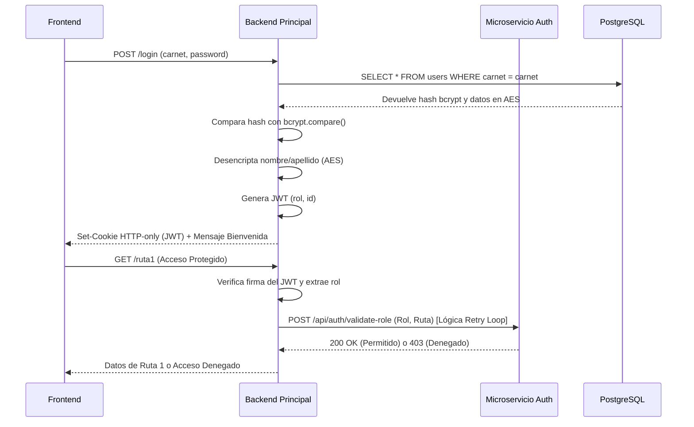

# Práctica 2 - Arquitectura de Software

Este proyecto implementa un sistema de registro e inicio de sesión seguro utilizando una arquitectura basada en microservicios, frontend moderno y bases de datos relacionales, cumpliendo con buenas prácticas de seguridad.

## Instrucciones de Ejecución

Para ejecutar este proyecto en tu entorno local, asegúrate de tener instalados **Docker**, **Docker Compose**, **Node.js** y **pnpm**.

1. **Clonar el repositorio y ubicarse en la raíz (`P2`)**
2. **Levantar la base de datos (PostgreSQL):**
   ```bash
   docker compose up -d --build
   ```
   *(La base de datos se inicializará automáticamente con la tabla `users` a través del script `init.sql`).*

3. **Iniciar el Microservicio de Autorización:**
   ```bash
   cd auth-service
   pnpm install
   pnpm run dev
   ```
   *(Correrá en el puerto 4000)*

4. **Iniciar el Backend Principal:**
   En una nueva terminal, desde la raíz `P2`:
   ```bash
   cd backend
   pnpm install
   pnpm run dev
   ```
   *(Correrá en el puerto 3000)*

5. **Iniciar el Frontend (React + Vite):**
   En una nueva terminal, desde la raíz `P2`:
   ```bash
   cd frontend
   pnpm install
   pnpm run dev
   ```
   *(Correrá en el puerto 5173)*

## Explicación de Tecnologías Seleccionadas

- **React + Vite (Frontend):** 
  - *Ventajas:* Vite proporciona un entorno de desarrollo extremadamente rápido y React permite crear interfaces interactivas y modulares. 
  - *Desventajas:* Requiere configuración adicional para SEO (aunque al ser un panel de admin, no es crítico) y puede tener una curva de aprendizaje inicial respecto al manejo de estados.
- **Node.js + Express + TypeScript (Backend y Microservicio):**
  - *Ventajas:* Tipado estático que previene errores en tiempo de ejecución, excelente rendimiento para I/O asíncrono y gran ecosistema.
  - *Desventajas:* Express es minimalista, por lo que requiere instalar y configurar librerías de terceros para casi todo (cors, cookies, seguridad).
- **PostgreSQL (Base de Datos):**
  - *Ventajas:* Motor relacional robusto, seguro, ACID-compliant y excelente para relaciones complejas.
  - *Desventajas:* Su configuración y mantenimiento son ligeramente más complejos que bases de datos NoSQL como MongoDB.
- **Docker:**
  - *Ventajas:* Garantiza que el entorno de base de datos sea idéntico en cualquier computadora (evitando el "en mi máquina sí funciona").
  - *Desventajas:* Consume más recursos del sistema operativo al virtualizar contenedores.

## Medidas de Seguridad Implementadas

1. **JWT (JSON Web Tokens) en Cookies HTTP-Only:** 
   En lugar de usar LocalStorage (vulnerable a ataques XSS), el token JWT se envía al frontend dentro de una cookie `HTTP-Only`. Esto significa que JavaScript en el navegador *no puede* leer el token.
2. **Encriptación AES:**
   Los nombres y apellidos de los usuarios se encriptan con AES antes de guardarse en la base de datos. AES es bidireccional, por lo que podemos desencriptar estos datos cuando el usuario inicia sesión para mostrarle un saludo personalizado.
3. **Hashing con bcrypt:**
   Las contraseñas **no** se encriptan con AES, sino que se "hashean" con bcrypt. El hash es unidireccional e irrecuperable. Es una de las mejores prácticas de la industria, ya que ni siquiera los administradores de la base de datos pueden conocer la contraseña del usuario.

## Diagrama de Secuencia del Flujo de Seguridad



## Los 5 Principios SOLID aplicados

1. **S - Single Responsibility Principle (Responsabilidad Única):**
   - *Explicación:* Cada módulo, clase o función debe tener un único propósito o responsabilidad dentro del sistema.
   - *Evidencia:* Se separó la lógica de conexión de la base de datos (`backend/src/utils/db.ts`), la lógica de seguridad (`backend/src/utils/security.ts`) y la lógica de tokens (`backend/src/utils/jwt.ts`). Cada archivo hace una sola cosa. Además, el Microservicio de Autorización tiene la única responsabilidad de validar roles, descargando al backend principal de esta tarea.

2. **O - Open/Closed Principle (Abierto/Cerrado):**
   - *Explicación:* El software debe estar abierto para extensión pero cerrado para modificación. (Puedes agregar funcionalidades sin alterar el código base existente).
   - *Evidencia:* En el microservicio de autorización (`auth-service/src/index.ts`), el objeto `routePermissions` actúa como un diccionario de reglas. Si el día de mañana se agregan nuevas rutas o nuevos roles, solo agregamos una nueva llave al diccionario sin tener que modificar la lógica condicional `if/else` que procesa la validación.

3. **L - Liskov Substitution Principle (Sustitución de Liskov):**
   - *Explicación:* Las clases derivadas (hijas) deben poder sustituir a sus clases base (padres) sin romper el funcionamiento del programa. Este principio aplica a los contratos e interfaces.
   - *Evidencia:* En TypeScript usamos interfaces como `TokenPayload`. Si en un futuro decidiéramos extender esta interfaz a `AdminTokenPayload extends TokenPayload`, cualquier función que espere un `TokenPayload` (como `generateToken`) seguirá funcionando perfectamente si le pasamos el objeto derivado.

4. **I - Interface Segregation Principle (Segregación de Interfaces):**
   - *Explicación:* Los clientes no deben verse obligados a depender de interfaces que no utilizan. Es mejor tener interfaces pequeñas y específicas que una sola interfaz gigantesca.
   - *Evidencia:* En React (Frontend), los componentes `Login.tsx`, `Register.tsx` y `Dashboard.tsx` manejan sus propios estados locales y dependencias sin estar acoplados a una interfaz global gigante. Cada uno consume únicamente los endpoints que necesita y requiere solo las `props` necesarias.

5. **D - Dependency Inversion Principle (Inversión de Dependencias):**
   - *Explicación:* Los módulos de alto nivel no deben depender de módulos de bajo nivel; ambos deben depender de abstracciones.
   - *Evidencia:* El frontend no sabe cómo el backend guarda los datos (PostgreSQL, Mongo, etc.), solo depende de la "abstracción" de la API REST (`/login`, `/register`). De igual forma, el Backend Principal delega la validación de roles usando el `authClient`, un cliente HTTP (`axios`) que abstrae la comunicación con el microservicio, en lugar de importar la lógica directamente.
