# Diseño de Arquitectura: Sistema de Procesamiento Bancario Masivo

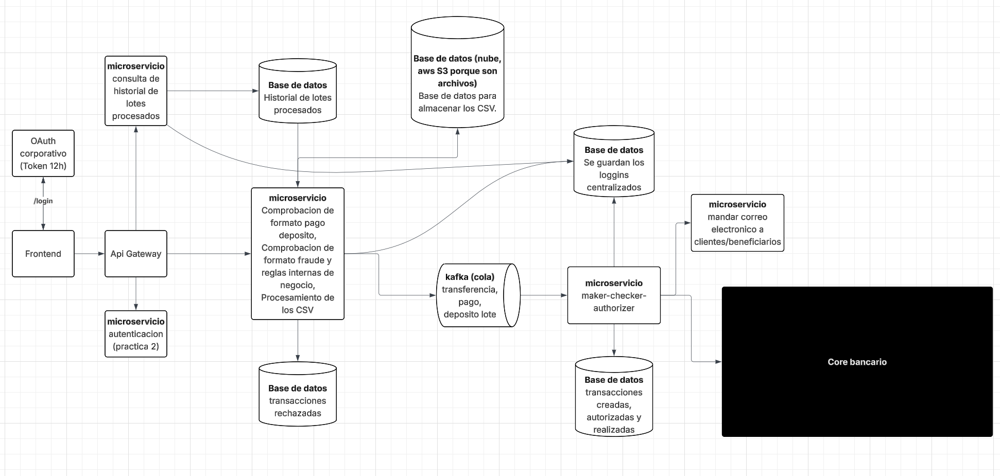

Este repositorio contiene el diseño arquitectónico inicial para resolver los problemas de rendimiento en épocas de alta demanda del sistema de procesamiento de transacciones, transicionando de un esquema monolítico a uno basado en microservicios y eventos.

---

## 1. Arquitectura General y Patrones Implementados

### Diagrama de Componentes UML

¿Qué representa?
Es la vista macro de la infraestructura. Muestra las piezas de software desplegadas y cómo se comunican por la red.

¿Por qué se diseñó así? (Justificación)
- **Persistencia Políglota**: Se utilizan diferentes bases de datos según el requerimiento. Se utiliza un Bucket S3 para archivos pesados, PostgreSQL para transacciones ACID, MongoDB para un historial de documentos flexible y BigQuery para soportar analítica columnar sobre millones de logs.
- **Arquitectura Orientada a Eventos**: Al colocar a Kafka en el centro de las operaciones asíncronas, rompemos las dependencias directas entre microservicios (evitando el acoplamiento HTTP). Si el servicio de Notificaciones se cae temporalmente, el Core Transaccional sigue funcionando y aprobando lotes sin enterarse; Kafka simplemente guardará los mensajes hasta que el servicio de correos vuelva a estar en línea.
- **Observabilidad Transversal**: Las líneas punteadas hacia la base de datos de Logging demuestran que el monitoreo es una responsabilidad compartida por todos los microservicios, cumpliendo con el requerimiento de auditoría centralizada.

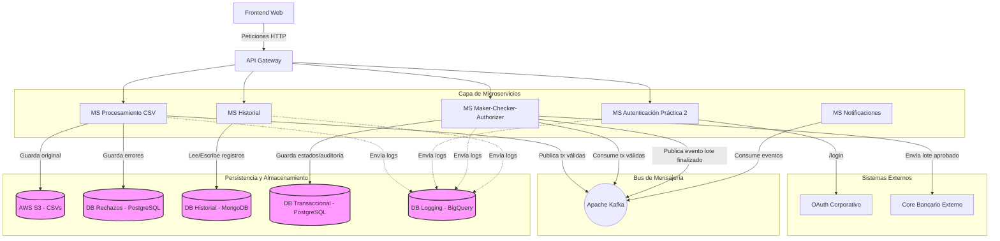

### Propuesta de API Gateway
El API Gateway se propone como el único punto de entrada público (Single Point of Entry) para el frontend y los clientes externos. Su función principal es actuar como un enrutador inverso que oculta la complejidad y la topología interna de la red de microservicios. Además de enrutar las peticiones al microservicio correspondiente, el Gateway descarga a los microservicios de responsabilidades transversales, asumiendo tareas como la terminación SSL y la delegación de la validación del token de seguridad hacia el microservicio de Autenticación.

### Uso e integración del servicio de Autenticación
Para garantizar la seguridad del sistema y cumplir con las normativas corporativas, la arquitectura implementa una estrategia de seguridad de doble capa. En primer lugar, se integra un servicio de autenticación OAuth corporativo que emite un token de acceso con un tiempo de vida de 12 horas. Una vez que el API Gateway recibe una petición HTTP, este intercepta el token y se apoya en el módulo de autenticación desarrollado en la Práctica 2. Este módulo se encarga de validar la identidad del usuario y gestionar los permisos internos, verificando estrictamente si la sesión activa posee los privilegios necesarios (rol de Maker, Checker o Authorizer) para ejecutar la acción solicitada.

### Estrategia de Comunicación entre Servicios (REST y Mensajería)
Para soportar el procesamiento de transacciones en épocas de alta demanda empresarial, el sistema emplea un enfoque de comunicación híbrido:
- **Comunicación Síncrona (REST):** Se utiliza exclusivamente para operaciones que requieren una respuesta inmediata hacia la interfaz de usuario, como el inicio de sesión, la carga inicial del archivo CSV, y las consultas directas al historial.
- **Comunicación Asíncrona (Mensajería con Apache Kafka):** Se implementa como el bus central del sistema para eventos pesados. Las transacciones válidas se envían por Kafka hacia el Core Transaccional. Del mismo modo, al aprobarse exitosamente un lote en el paso final (Authorizer), se publica un evento en el bus para que el microservicio de Notificaciones envíe los correos en segundo plano, logrando un total desacoplamiento.

---

## 2. Flujo Crítico de Aprobación (3 Pasos)

### Diagrama de Secuencia UML

¿Qué representa?
Es la vista cronológica del sistema. Muestra exactamente en qué orden se comunican los componentes a través del tiempo cuando un usuario corporativo intenta aprobar un lote.

¿Por qué se diseñó así? (Justificación)
- **Seguridad Centralizada**: Se colocó al API Gateway y al MS de Autenticación como los primeros interceptores. El core transaccional nunca confía ciegamente en una petición web; el Gateway siempre valida el token primero.
- **Manejo de Estados**: Demuestra cómo la misma ruta de API (`/aprobar`) reacciona distinto dependiendo del estado actual del lote, avanzando secuencialmente de `Pendiente_Checker` a `Lote_Completado`.
- **Desacoplamiento Asíncrono (Kafka)**: Al final del paso 3, el servicio no espera a que se envíen los correos. En su lugar, publica un evento en Kafka y le devuelve un `200 OK` rápido al usuario. Esto evita que el frontend se quede esperando confirmaciones, delegando esa carga al microservicio de Notificaciones.

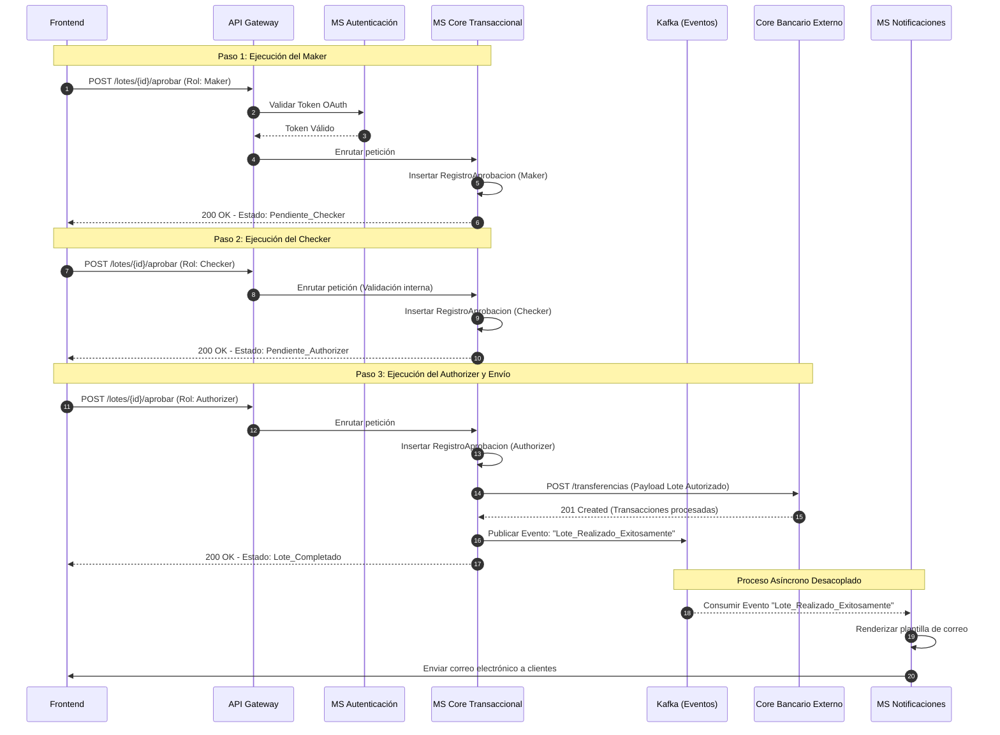

---

## 3. Diagramas de Clases UML por Microservicio

### Microservicio Core Transaccional (Maker-Checker-Authorizer)

¿Qué representa?
Refleja cómo se estructuran los datos en la memoria y la lógica interna del microservicio principal.

¿Por qué se diseñó así? (Justificación)
- **Diseño Orientado al Dominio (DDD)**: Se definió `LoteTransaccional` como la "Entidad Raíz". En la industria bancaria, las aprobaciones corporativas se hacen por archivos masivos. Cambiar el estado de la cabecera actualiza lógicamente miles de transacciones.
- **Separación de Auditoría**: La clase `RegistroAprobacion` es la clave para cumplir con las reglas del negocio. Al separar la bitácora de la tabla de transacciones, garantizamos que el sistema pueda verificar si el usuario que intenta actuar como Checker es diferente al Maker, creando un historial inalterable para auditorías.

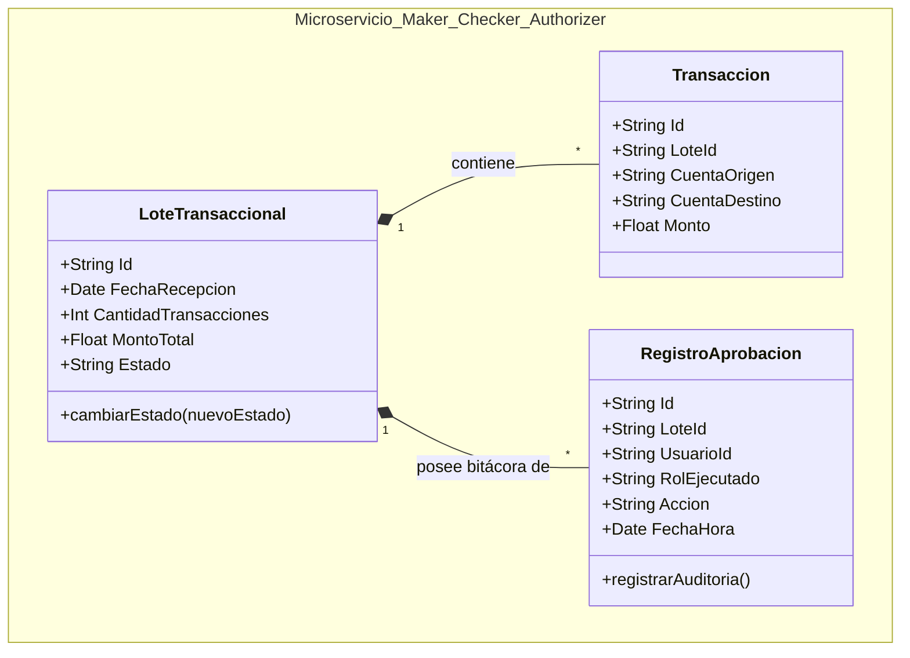

### Microservicio de Procesamiento CSV

Este diagrama refleja las entidades encargadas de recibir el archivo masivo y aplicar las reglas del negocio.

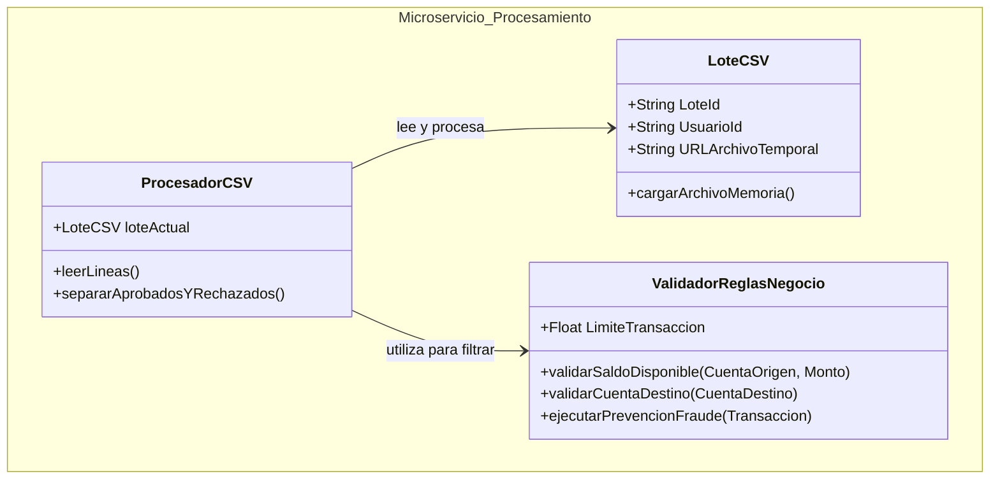

### Microservicio de Historial de Lotes

Este diagrama muestra la estructura para gestionar el registro histórico y la conexión con el almacenamiento en la nube (AWS S3).

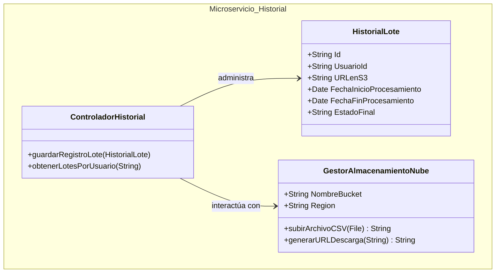

### Microservicio de Notificaciones

Este componente reacciona a los eventos asíncronos del sistema para informar a los beneficiarios.

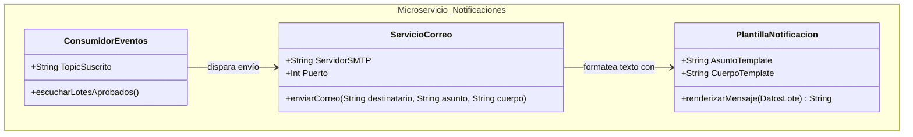

---

## 4. Modelos de Datos (Diagramas ER)

### Base de datos: Transacciones creadas, autorizadas y realizadas (Core Transaccional)
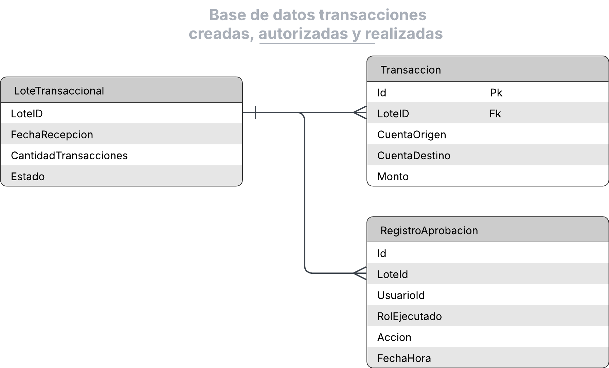

### Base de datos: Historial de lotes procesados
Esta base de datos utiliza una estructura NoSQL orientada a documentos para guardar el estado final y tiempos de procesamiento.
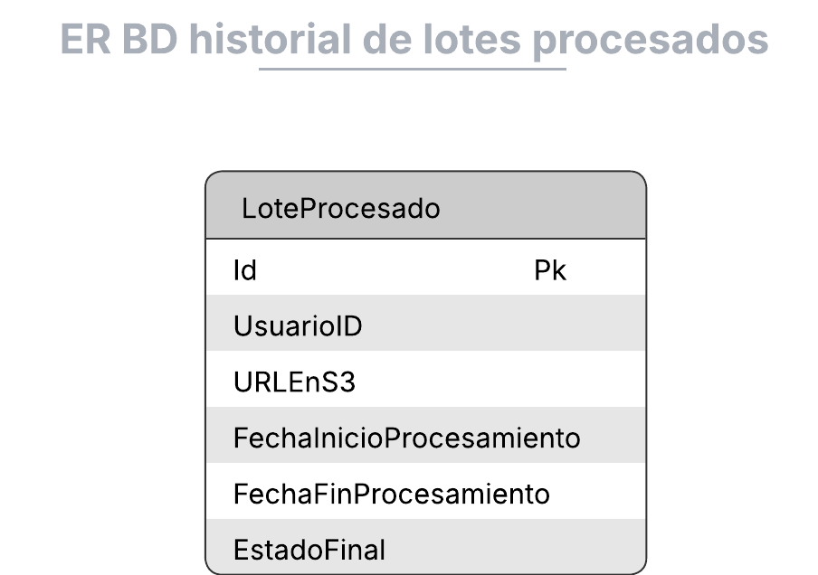

Estructura de documento propuesta:
```json
[
  {
    "_id": "lote_12345",
    "usuarioId": "user_789",
    "urlS3": "s3://bucket-banco/lotes/12345.csv",
    "tiempos": {
       "inicio": "2026-08-12T10:00:00Z",
       "fin": "2026-08-12T10:05:00Z"
    },
    "estadoFinal": "Procesado"
  }
]
```

### Base de datos: Para almacenar los CSV originales
Se guardará en la nube, utilizando **AWS S3** o similar, ya que está optimizado para el guardado de archivos. La ruta de acceso (URL) se almacena referenciada en la base de datos de Historial.

### Base de datos: Transacciones rechazadas
Para almacenar las transacciones que no pasaron las reglas de negocio, y el motivo exacto del rechazo.
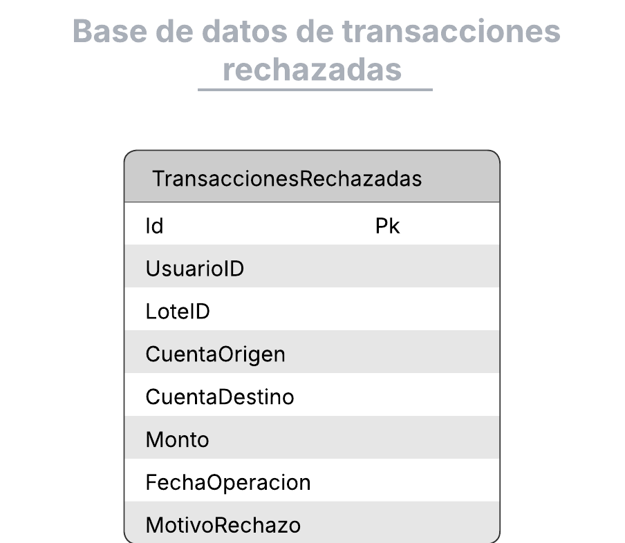

### Base de datos: Logging centralizado
Para este caso, donde existe la necesidad de filtrar registros por múltiples dimensiones (tipo de log, fecha, microservicio), se propone una estrategia de almacenamiento híbrida:
- **Almacenamiento en caliente** (menor a 30 días): Base de datos NoSQL para optimizar escritura.
- **Almacenamiento histórico** (mayor a 30 días): Base de datos columnar como **BigQuery** para consultas analíticas eficientes y económicas.
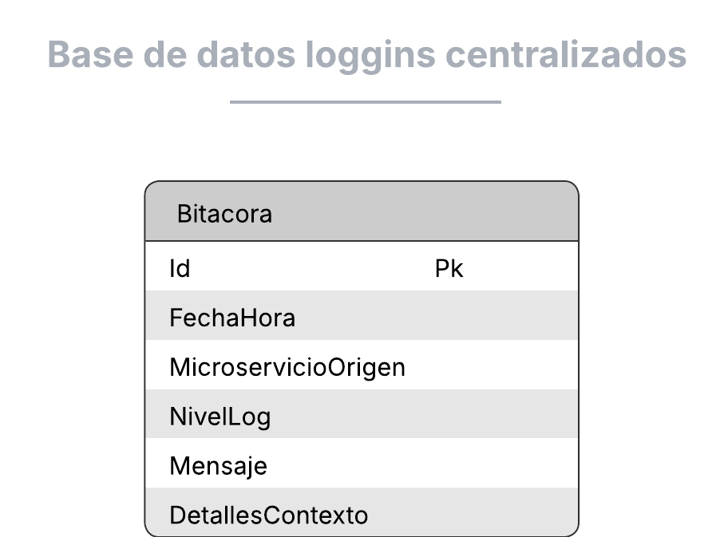

---

## 5. Principios SOLID Aplicados en el Diseño Arquitectónico

A continuación, se detalla la explicación de los 5 principios SOLID y la evidencia de su aplicación en el diseño de las clases y microservicios propuestos.

### S - Single Responsibility Principle (Principio de Responsabilidad Única)
**Explicación:** Una entidad (clase o módulo) debe tener una única razón para cambiar, encargándose de una sola tarea dentro del sistema.
**Evidencia en el diseño:**
La clase `ValidadorReglasNegocio` (en el MS de Procesamiento) se encarga únicamente de aplicar las reglas de negocio (saldo, límites, prevención de fraude). No contiene lógica de conexión a bases de datos ni parseo del CSV; esas tareas pertenecen a `ProcesadorCSV` y `LoteCSV`.

### O - Open/Closed Principle (Principio de Abierto/Cerrado)
**Explicación:** Las entidades deben estar abiertas para la extensión, pero cerradas para la modificación (agregar nueva funcionalidad sin alterar el diseño existente).
**Evidencia en el diseño:**
En el MS de Notificaciones, la clase `ServicioCorreo` maneja el envío de notificaciones. Si a futuro el negocio requiere notificar también por SMS o WhatsApp, se extendería mediante una interfaz de notificación polimórfica, sin tener que modificar o romper la lógica existente que envía correos electrónicos.

### L - Liskov Substitution Principle (Principio de Sustitución de Liskov)
**Explicación:** Las clases derivadas deben poder sustituir a sus clases base sin alterar el correcto funcionamiento del programa.
**Evidencia en el diseño:**
La abstracción `GestorAlmacenamientoNube` (en el MS de Historial) define los métodos genéricos para subir archivos. Una implementación concreta como `GestorS3` podría ser sustituida por un `GestorGCPStorage` sin que el resto del microservicio se entere, asegurando un comportamiento predecible.

### I - Interface Segregation Principle (Principio de Segregación de Interfaces)
**Explicación:** Los clientes no deben verse obligados a depender de interfaces que no utilizan. Es mejor tener muchas interfaces específicas.
**Evidencia en el diseño:**
En el diseño del Core Transaccional, la lógica de validación de auditoría (para asegurar que el Maker es distinto del Checker) no se mezcla en la clase `Transaccion`. Las responsabilidades se dividen para que las consultas de transacciones no dependan de los métodos de auditoría de `RegistroAprobacion`.

### D - Dependency Inversion Principle (Principio de Inversión de Dependencias)
**Explicación:** Los módulos de alto nivel no deben depender de módulos de bajo nivel; ambos deben depender de abstracciones (interfaces).
**Evidencia en el diseño:**
El `ProcesadorCSV` no se acopla a una implementación concreta de Kafka. A nivel de diseño, depende de una abstracción de publicación de eventos. Esto permite que la infraestructura de mensajería (sea Kafka, RabbitMQ o AWS SQS) se inyecte independientemente de la lógica central del procesamiento de lotes.
