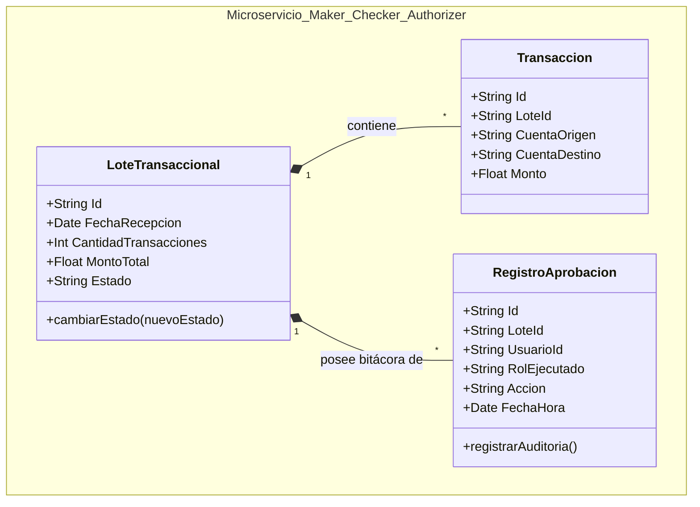
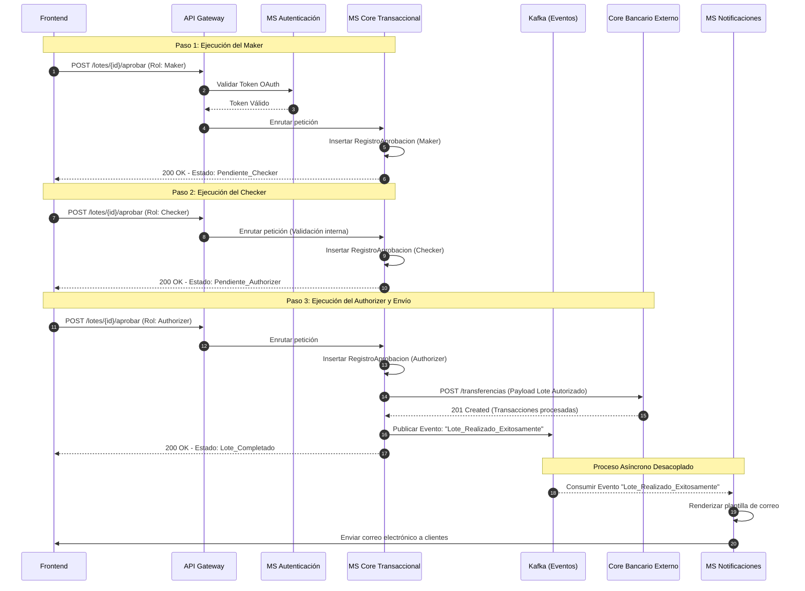
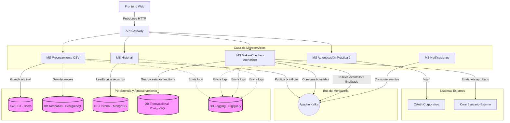

# ER de microservicios
## Base de datos: Histiral de lotes procesados


esta al ser una simple tabla, recomiendo que sea NoSQL ya que en este caso al ser una simple tabla que no se puede normalizar va a funcionar de mejor manera, la estructura propuesta es la siguiente:
```json
[
  {
    "_id": "lote_12345",
    "usuarioId": "user_789",
    "urlS3": "s3://bucket-banco/lotes/12345.csv",
    "tiempos": {
       "inicio": "2026-08-12T10:00:00Z",
       "fin": "2026-08-12T10:05:00Z"
    },
    "estadoFinal": "Procesado"
  },
  {
    "_id": "lote_12346",
    "usuarioId": "user_404",
    "urlS3": "s3://bucket-banco/lotes/12346.csv",
    "tiempos": {
       "inicio": "2026-08-12T11:15:00Z",
       "fin": "2026-08-12T11:15:30Z"
    },
    "estadoFinal": "Rechazado"
  }
]
```

## Base de datos: Para almacenar los CSV

Se guardará en la nube, al ser archivos recomendaria utilizar S3 ya que esa se basa en guardado por archivos, si se necesita referenciar a algun CSV de estos, estará almacenada la ruta de acceso a estos en la base de datos anterior, su estructura es la siguiente:

## Base de datos: Transacciones rechazadas

.png>)


```json
[
  {
    "_id": "rech_98765a",
    "usuarioID": "usr_corp_042",
    "loteID": "lote_20260812_01",
    "cuentaOrigen": "3000123456",
    "cuentaDestino": "4000987654",
    "monto": 25000.00,
    "fechaOperacion": "2026-08-12T12:20:00Z",
    "motivoRechazo": "Saldo disponible insuficiente"
  },
  {
    "_id": "rech_98765b",
    "usuarioID": "usr_corp_042",
    "loteID": "lote_20260812_01",
    "cuentaOrigen": "3000123456",
    "cuentaDestino": "0000000000",
    "monto": 150.50,
    "fechaOperacion": "2026-08-12T12:20:01Z",
    "motivoRechazo": "Regla de prevención de fraude: cuenta de destino no válida"
  }
]
```

## Base de datos: Se guardan los loggins centralizados

Para este caso, donde existe la necesidad de filtrar registros por múltiples dimensiones (tipo de log, fecha, microservicio y cuentas involucradas), se propone una estrategia de almacenamiento híbrida.

Para el almacenamiento en caliente (logs menores a 30 días), se utilizará una base de datos NoSQL orientada a documentos para optimizar la escritura. Para el almacenamiento histórico (logs mayores a 30 días), se optará por una base de datos columnar como BigQuery, lo cual permite trasladar los datos a un nivel más económico y aprovechar su estructura para consultas eficientes.

.png>)

## Base de datos: Transacciones creadas, autorizadas y realizadas


## Diagrama de Clases UML (Microservicio Core Transaccional)

¿Qué representa?
Es la estructura interna orientada a objetos de tu microservicio principal (Maker-Checker-Authorizer). Refleja cómo se estructuran los datos en la memoria y en la base de datos relacional.

¿Por qué se diseñó así? (Justificación)

Diseño Orientado al Dominio (DDD): Se definió LoteTransaccional como la "Entidad Raíz". En la industria bancaria, las aprobaciones corporativas no se hacen transferencia por transferencia, sino por archivos masivos. Cambiar el estado de la cabecera actualiza lógicamente miles de transacciones de un solo golpe.

Separación de Auditoría: La clase RegistroAprobacion es la clave para cumplir con las reglas del negocio. Al separar la bitácora de la tabla de transacciones puras, garantizamos que el sistema pueda verificar si el usuario que intenta actuar como Checker es diferente al que actuó como Maker, creando un historial inalterable para auditorías financieras.



# Diagrama de Secuencia UML (Flujo Crítico de 3 Pasos)

¿Qué representa?
Es la vista cronológica del sistema. Muestra exactamente en qué orden se comunican los componentes a través del tiempo cuando un usuario corporativo intenta aprobar un lote.

¿Por qué se diseñó así? (Justificación)

Seguridad Centralizada: Se colocó al API Gateway y al MS de Autenticación como los primeros interceptores. El core transaccional nunca confía ciegamente en una petición web; el Gateway siempre valida el token primero.

Manejo de Estados: Demuestra cómo la misma ruta de API (/aprobar) reacciona distinto dependiendo del estado actual del lote, avanzando secuencialmente de Pendiente_Checker a Lote_Completado.

Desacoplamiento Asíncrono (Kafka): Nota cómo, al final del paso 3, el servicio no espera a que se envíen los correos. En su lugar, publica un evento en Kafka y le devuelve un 200 OK rápido al usuario. Esto evita que el frontend se quede "congelado" esperando confirmaciones de servidores de correo externos, delegando esa carga al microservicio de Notificaciones en segundo plano.



# Diagrama de Componentes UML

¿Qué representa?
Es la vista de "pájaro" o el mapa macro de toda tu infraestructura. Muestra las piezas de software desplegadas y cómo se comunican por la red.

¿Por qué se diseñó así? (Justificación)

Persistencia Políglota: El diagrama justifica visualmente por qué usamos diferentes bases de datos según el requerimiento. Se utiliza un Bucket S3 para archivos pesados, PostgreSQL para transacciones ACID exactas, MongoDB para un historial de documentos flexible y BigQuery para soportar analítica columnar sobre millones de logs.

Arquitectura Orientada a Eventos: Al colocar a Kafka en el centro de las operaciones de éxito, rompemos las dependencias directas entre microservicios (evitando el acoplamiento HTTP). Si el servicio de Notificaciones se cae temporalmente, el Core Transaccional sigue funcionando y aprobando lotes sin enterarse; Kafka simplemente guardará los mensajes hasta que el servicio de correos vuelva a estar en línea.

Observabilidad Transversal: Las líneas punteadas hacia la base de datos de Logging demuestran que el monitoreo es una responsabilidad compartida por todos los microservicios, cumpliendo con el requerimiento de auditoría centralizada.


