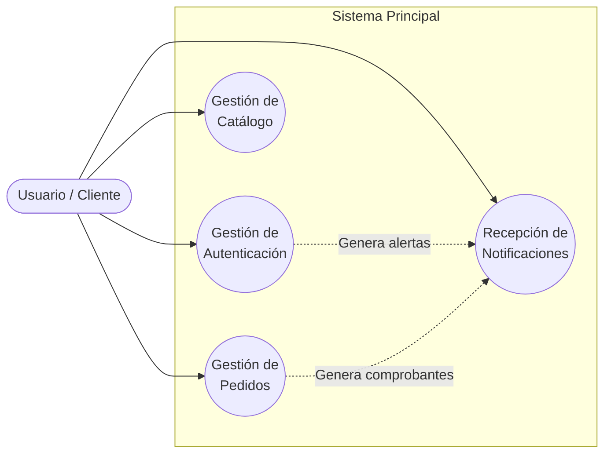
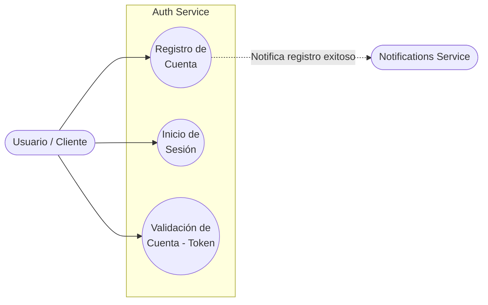
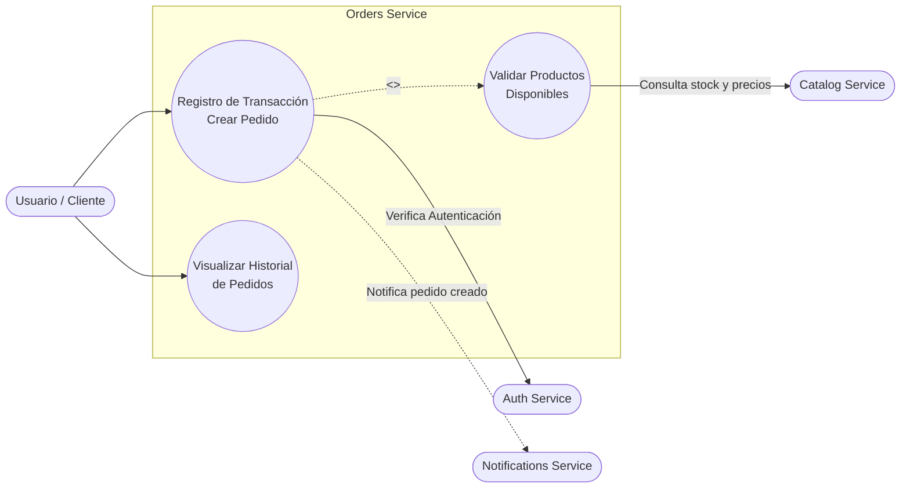
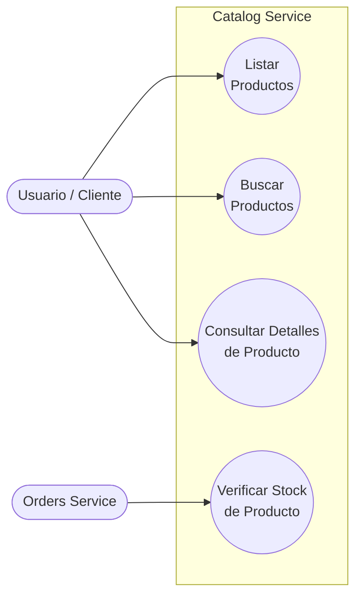
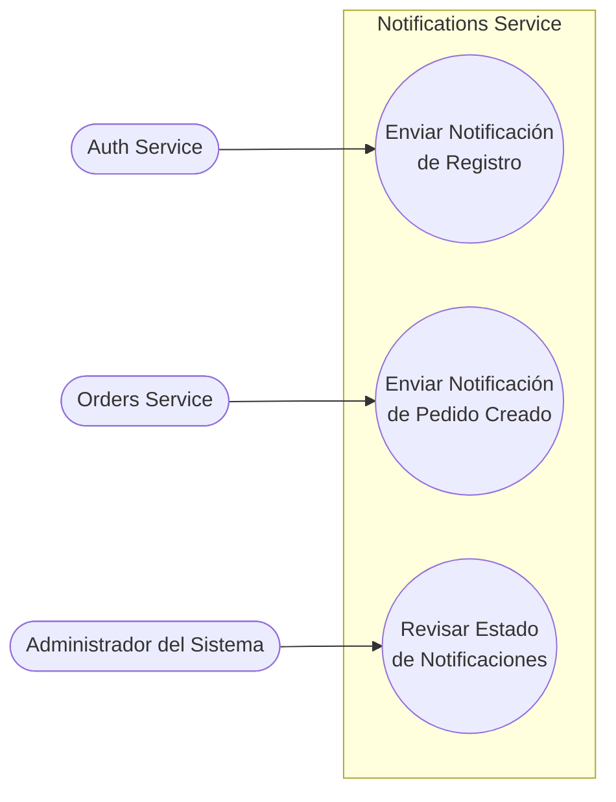

# Diagramas de Casos de Uso

A continuación se presenta el diagrama de casos de uso de **alto nivel** que ilustra el panorama general del sistema, seguido de las **descomposiciones** específicas para cada uno de los microservicios.

## Diagrama de Alto Nivel (Contexto General)

Este diagrama muestra cómo el usuario interactúa con los grandes módulos del sistema, tratando a cada microservicio como un caso de uso global.

---

## Descomposición por Microservicio
## 1. Auth Service

El microservicio de autenticación se encarga de la gestión y validación de las cuentas de los usuarios.

## 2. Orders Service

El microservicio de pedidos (órdenes) maneja el registro de transacciones y el historial de compras.

## 3. Catalog Service

El microservicio de catálogo maneja la visualización y búsqueda de productos.

## 4. Notifications Service

El microservicio de notificaciones actúa de forma reactiva al recibir eventos de otros servicios.

