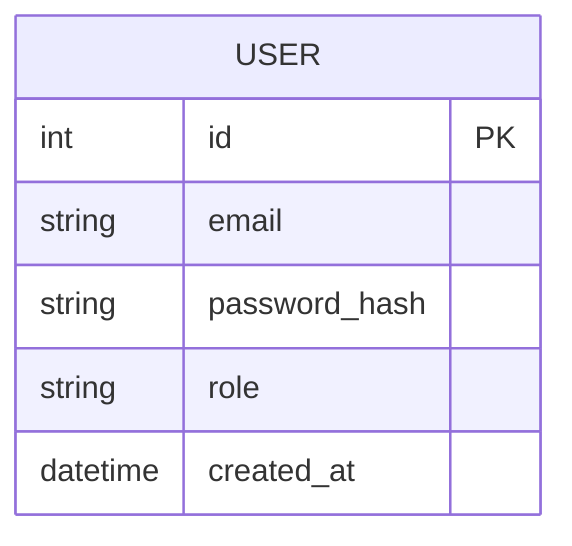
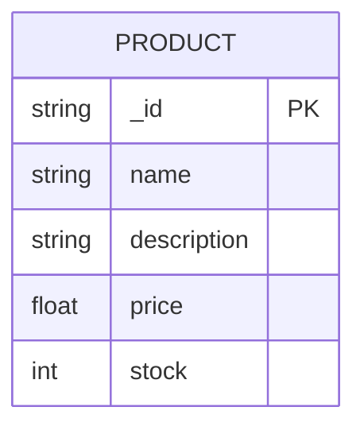
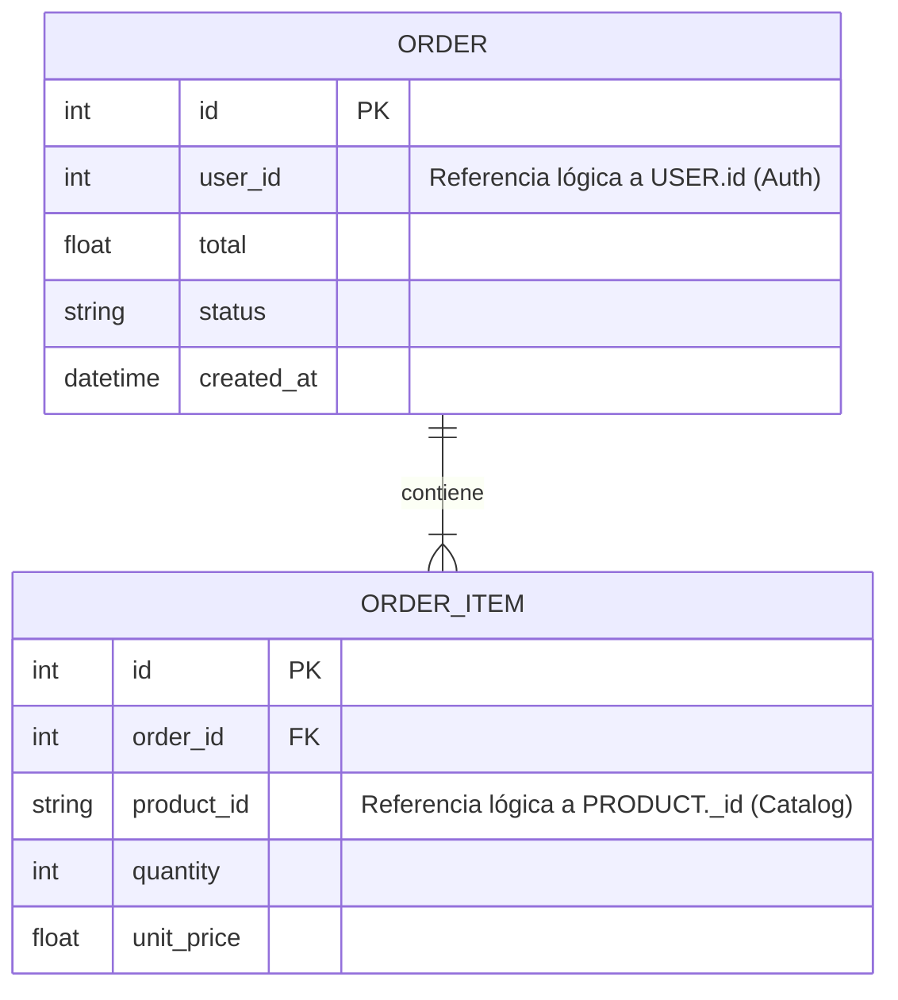

# Diagramas Entidad-Relación (ER)

Diseño de las bases de datos para cada uno de los microservicios que requieren persistencia. En una arquitectura de microservicios, las bases de datos están desacopladas y gestionadas de forma independiente por cada servicio.

## Base de Datos: Auth Service (PostgreSQL)

## Base de Datos: Catalog Service (MongoDB)

## Base de Datos: Orders Service (PostgreSQL)

