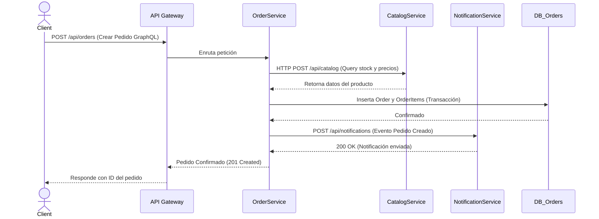

# Diagrama de Secuencia (Creación de Pedido)

Este diagrama ejemplifica el flujo de información cuando un usuario realiza una compra, interactuando con los distintos microservicios a través del Gateway.

