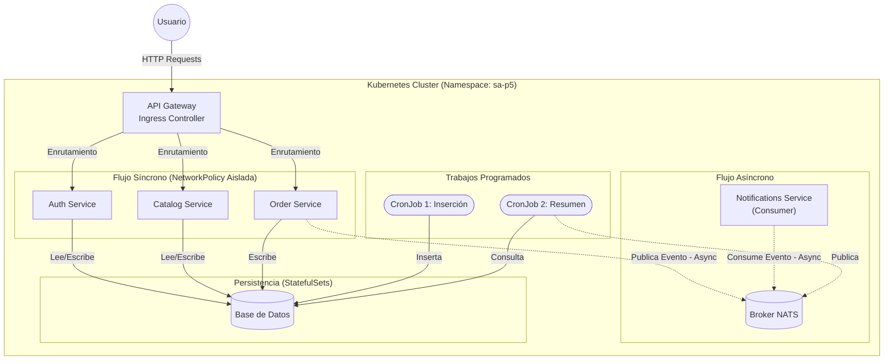
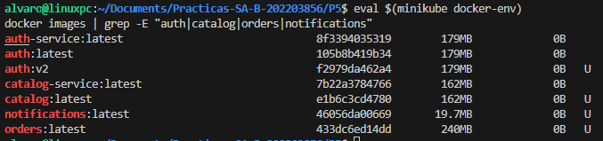
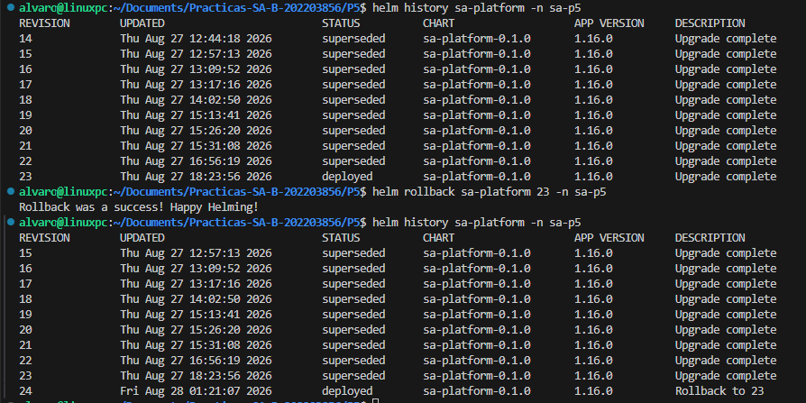
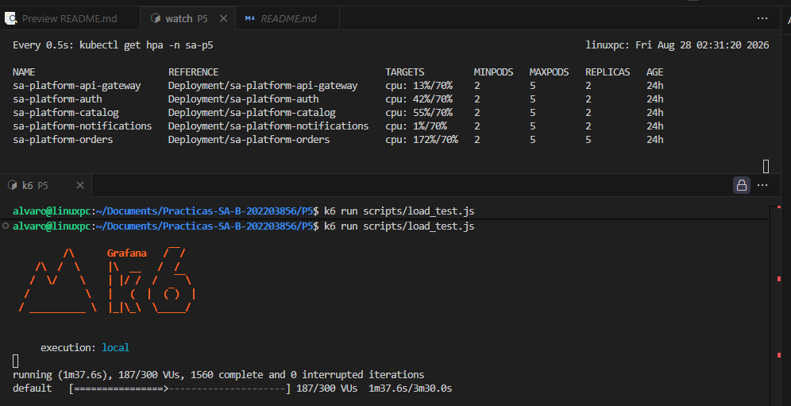
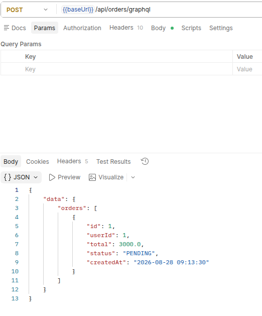
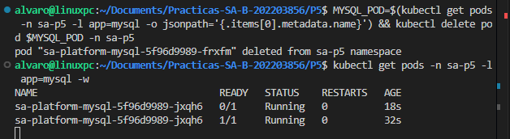
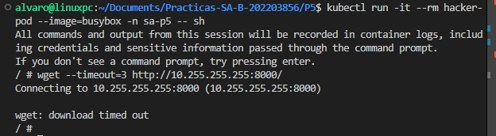
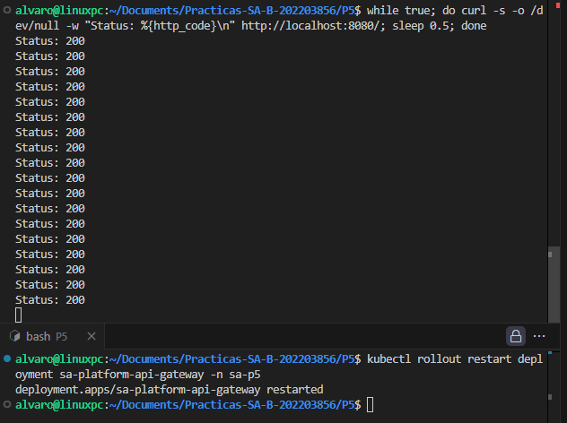
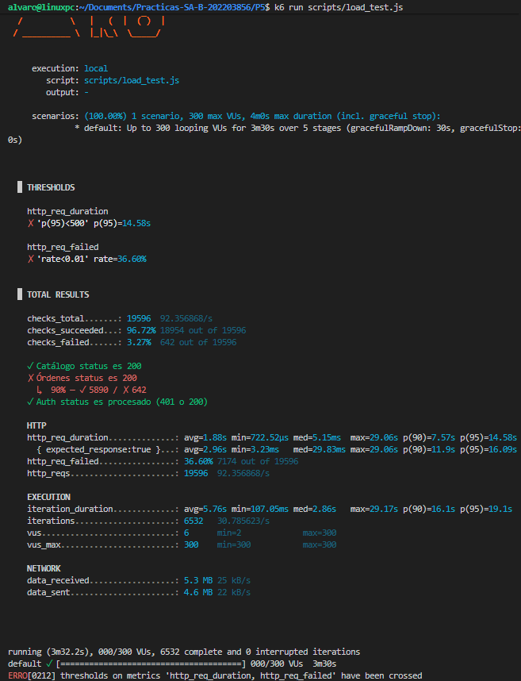

# Reporte Práctica 5 - Orquestación avanzada de microservicios en Kubernetes con Helm

## 1. Arquitectura y Diagramas



---

## 2. Detalle Reproducible de Comandos


1. **Iniciar Minikube:**
   ```bash
   minikube start
   eval $(minikube docker-env)
   ```
2. **Construir Imágenes de forma local:**
   ```bash
   docker build -t api-gateway:latest ./api-gateway
   docker build -t auth:latest ./auth/auth-service
   docker build -t catalog:latest ./catalog/catalog-service
   docker build -t notifications:latest ./notifications/notification-service
   docker build -t orders:latest ./orders/order-service
   ```
3. **Desplegar con Helm:**
   ```bash
   kubectl create namespace sa-p5
   helm dependency update ./charts/sa-platform
   helm install sa-platform ./charts/sa-platform -n sa-p5 -f ./charts/sa-platform/values-dev.yaml
   ```

---

## 3. Tabla Comparativa de Imágenes (Multi-stage)


---

## 4. Evidencias Prácticas

### 4.1 Helm Rollback


### 4.2 Escalado por HPA bajo carga


### 4.3 Persistencia tras el borrado del pod de Base de Datos



### 4.4 Bloqueo por NetworkPolicy


### 4.5 Actualización sin Downtime (RollingUpdate)


---

## 5. Resultados de la Prueba de Carga



- **Herramienta utilizada:** k6
- **Peticiones por Segundo (RPS / http_reqs):** `92.35 req/s`
- **Latencia p95 (http_req_duration p(95)):** `14.58s`
- **Tasa / Porcentaje de error (http_req_failed):** `36.60%`

---

## 6. Preguntas Teóricas

**1. ¿Qué es Helm y qué problema resuelve frente a los manifiestos sueltos?**
Helm es el manejador de paquetes para Kubernetes. Resuelve el problema de la gestión y repetitividad de los despliegues. Frente a tener docenas de archivos YAML estáticos dispersos (`manifiestos sueltos`), Helm permite agrupar la infraestructura en "Charts" paramétricos (plantillas). Esto facilita el despliegue con un solo comando, el versionado sistemático de las infraestructuras, la reutilización del código mediante variables (`values.yaml`), y la capacidad de realizar *upgrades* y *rollbacks* gestionando el estado global de la aplicación, en lugar de recurso por recurso.

**2. ¿Diferencia entre chart, release y repository?**
- **Chart:** Es el paquete de Helm. Consiste en una colección de archivos que describen (mediante plantillas) un conjunto de recursos relacionados de Kubernetes. Es equivalente al "código fuente".
- **Release:** Es una instancia en ejecución de un chart en el clúster. Cuando instalas un chart, Helm crea un *Release*. Puedes instalar el mismo chart múltiples veces, obteniendo múltiples releases independientes.
- **Repository:** Es el lugar (servidor HTTP) donde se almacenan y comparten los charts empaquetados para que puedan ser descubiertos y descargados.

**3. ¿Qué es un StatefulSet y cuándo NO usarlo?**
Un StatefulSet es un objeto de la API de Kubernetes usado para gestionar aplicaciones *con estado* (stateful). A diferencia de un Deployment (cuyos pods son intercambiables y efímeros), un StatefulSet garantiza el orden de despliegue, y asegura que cada pod mantenga una identidad de red fija (nombre consistente) y un almacenamiento persistente atado permanentemente a él (PVC exclusivo).
**Cuándo NO usarlo:** No debe usarse para microservicios *stateless* (sin estado), como APIs REST o servidores web frontend, ya que en estos casos los pods sí pueden y deben ser efímeros e intercambiables, haciendo a un `Deployment` mucho más ligero y adecuado.

**4. ¿Diferencia entre liveness, readiness y startup probe?**
- **Startup Probe:** Verifica si la aplicación dentro del contenedor ha arrancado correctamente (especialmente útil para apps legadas que tardan mucho en iniciar). Mientras corre, deshabilita las otras dos. Si falla, reinicia el contenedor.
- **Readiness Probe:** Verifica si el pod está listo para empezar a recibir tráfico de red. Si falla, el pod no se reinicia, simplemente se remueve de los endpoints del `Service`, dejando de enviarle peticiones hasta que se recupere.
- **Liveness Probe:** Verifica continuamente si la aplicación sigue viva y funcionando durante su ciclo de vida. Si falla (por un deadlock, etc.), Kubernetes mata el contenedor y lo reinicia.

**5. ¿Qué es una NetworkPolicy y por qué el tráfico es permitido por defecto?**
Una NetworkPolicy es un conjunto de reglas a nivel de red (Capa 3 y 4 del modelo OSI) en Kubernetes que dicta cómo los grupos de pods pueden comunicarse entre sí y con otros endpoints (actúa como un Firewall interno). 
El tráfico en Kubernetes es permitido por defecto (comunicación de todos hacia todos) por diseño, para facilitar el descubrimiento inicial, el *networking* distribuido y garantizar la menor fricción en entornos de desarrollo; priorizando la flexibilidad. El aislamiento debe habilitarse explícitamente *opt-in* aplicando NetworkPolicies restrictivas.

**6. ¿Qué es un PodDisruptionBudget (PDB)?**
Un PDB es una política que limita el número de pods concurrentes de una aplicación replicada que pueden estar inactivos (caídos) debido a **disrupciones voluntarias** (como el drenaje de nodos para mantenimiento, escalado de clúster, actualizaciones). Garantiza la alta disponibilidad forzando a Kubernetes a respetar un número mínimo de réplicas disponibles (`minAvailable`) o un número máximo indisponible (`maxUnavailable`) antes de permitir que un nodo se apague o un pod sea desalojado.

**7. ¿Qué ventajas y qué nuevos problemas introduce la comunicación asíncrona?**
**Ventajas:**
- Desacoplamiento temporal y espacial de microservicios: El emisor no necesita saber quién, ni cuándo consumirá su mensaje.
- Tolerancia a fallos: Si el consumidor se cae, el mensaje queda seguro y duradero en el broker, procesándose cuando el servicio reviva sin que el cliente note un error.
- Manejo fluido de picos de carga: El broker actúa como "amortiguador" (buffer) impidiendo saturar las bases de datos.
**Nuevos Problemas:**
- Complejidad en la trazabilidad: Hacer *debugging* de una petición que fluye por múltiples colas es difícil sin herramientas de observabilidad complejas.
- Consistencia eventual: Los datos no se actualizan instantáneamente, lo que requiere manejar estados intermedios y lidiar con latencia.
- Manejo de duplicados y *Poison Pills*: Se requiere lógica de idempotencia si un mensaje se entrega dos veces, y lidiar con mensajes que causan errores infinitos y bloquean la cola (*Dead Letter Queues*).

**8. ¿Qué hace `helm rollback` internamente?**
Internamente, Helm no revierte el control de versiones en el repositorio. Lo que hace es consultar el historial de versiones del *release* (guardado como secretos o configmaps especiales dentro del propio namespace del clúster). Recupera los manifiestos generados y la configuración (los *values*) que se utilizaron exitosamente en esa revisión anterior, los recompila y ejecuta un parche (`patch/apply`) sobre el clúster actual, forzando a que la infraestructura regrese al estado exacto de esa revisión, creando a su vez un **nuevo registro** en el historial como una nueva revisión.
