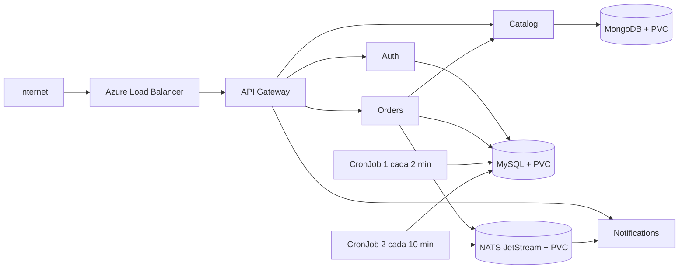

# Práctica 6 - Plataforma de microservicios en Azure AKS

Esta carpeta contiene la adaptación para nube de la plataforma construida en la práctica anterior. El despliegue se realiza con un único chart padre de Helm y no modifica ningún archivo de `P5`.

## Estado verificado

Fecha de la última validación: **4 de septiembre de 2026** (reinstalación limpia tras corregir el token de NATS).

| Elemento | Valor observado |
| --- | --- |
| Proveedor | Microsoft Azure |
| Servicio administrado | Azure Kubernetes Service (AKS), tier `Free` |
| Resource group | `rg-practica6` |
| Clúster | `aks-sa-p6` |
| Región | `chilecentral` |
| Kubernetes | `1.35.7` |
| Nodos | 2 `Standard_DS2_v2`, ambos `Ready` (autoscaler fijado en 2-2) |
| Namespace de la plataforma | `sa-p5` |
| Release | `sa-platform`, chart `0.2.0`, revisión 1, instalación limpia |
| Punto de entrada | Service `LoadBalancer` del API Gateway |
| IP pública observada | `57.156.9.223` |
| StorageClass | `managed-csi`, discos `StandardSSD_LRS` |
| NetworkPolicy | `azure` (Azure Network Policy Manager), estado `Succeeded`, verificada bloqueando tráfico de un pod no autorizado |

La IP es dinámica y puede cambiar si se recrea el Service. El valor vigente siempre debe obtenerse con:

```bash
kubectl get service sa-platform-api-gateway -n sa-p5
```

Se comprobaron los healthchecks públicos, autenticación, creación de un producto, creación de un pedido, publicación/consumo asíncrono en NATS, ambos CronJobs y persistencia de MySQL después de recrear su pod. El detalle está en [docs/EVIDENCIAS.md](docs/EVIDENCIAS.md).

## Arquitectura desplegada



Todos los servicios internos son `ClusterIP`; únicamente el API Gateway usa `LoadBalancer`. MySQL y MongoDB son `StatefulSet` con Service headless y PVC. NATS utiliza JetStream con almacenamiento de archivos persistente.

## Imágenes publicadas

Las imágenes son privadas y están publicadas en GHCR. P6 consume tags inmutables `v1.0.0`; como no fue necesario cambiar el código de la aplicación, las fuentes de P5 no se copiaron ni modificaron.

| Componente | Imagen |
| --- | --- |
| API Gateway | `ghcr.io/elfbibv/sa-api-gateway:v1.0.0` |
| Auth | `ghcr.io/elfbibv/sa-auth-service:v1.0.0` |
| Catalog | `ghcr.io/elfbibv/sa-catalog-service:v1.0.0` |
| Orders | `ghcr.io/elfbibv/sa-order-service:v1.0.0` |
| Notifications | `ghcr.io/elfbibv/sa-notification-service:v1.0.0` |
| CronJob 1 | `ghcr.io/elfbibv/sa-cron1:v1.0.0` |
| CronJob 2 | `ghcr.io/elfbibv/sa-cron2:v1.0.0` |

## Archivos principales

- `charts/sa-platform/Chart.yaml`: chart padre y sus ocho dependencias.
- `charts/sa-platform/values.yaml`: valores base sin credenciales.
- `charts/sa-platform/values-dev.yaml`: ajustes del ambiente de desarrollo.
- `charts/sa-platform/values-prod.yaml`: ajustes del ambiente productivo.
- `charts/sa-platform/values-azure.yaml`: imágenes, exposición y almacenamiento para AKS.
- `charts/sa-platform/values.example.yaml`: nombres ficticios de Secrets externos.
- `scripts/smoke-test.sh`: prueba funcional desde la IP pública.

## Procedimiento reproducible

### 1. Variables y sesión de Azure

```bash
export RESOURCE_GROUP="rg-practica6"
export AKS_CLUSTER="aks-sa-p6"
export LOCATION="chilecentral"
export NAMESPACE="sa-p5"
export RELEASE="sa-platform"

az login
az account set --subscription "Azure for Students"
```

Antes de crear recursos, se deben revisar tanto la cuota regional como la cuota de la familia elegida:

```bash
az vm list-usage --location "$LOCATION" --output table
az vm list-skus --location "$LOCATION" --resource-type virtualMachines --all --output table
```

### 2. Crear un AKS nuevo

Estos comandos representan la configuración recomendada para una creación limpia. Cilium permite que Kubernetes aplique las `NetworkPolicy` del chart.

```bash
az group create --name "$RESOURCE_GROUP" --location "$LOCATION"

az aks create \
  --resource-group "$RESOURCE_GROUP" \
  --name "$AKS_CLUSTER" \
  --location "$LOCATION" \
  --tier free \
  --node-count 2 \
  --node-vm-size Standard_DS2_v2 \
  --network-plugin azure \
  --network-plugin-mode overlay \
  --network-dataplane cilium \
  --generate-ssh-keys

az aks get-credentials \
  --resource-group "$RESOURCE_GROUP" \
  --name "$AKS_CLUSTER" \
  --overwrite-existing

kubectl get nodes
```

Si el clúster ya existe, primero se debe comprobar su configuración:

```bash
az aks show \
  --resource-group "$RESOURCE_GROUP" \
  --name "$AKS_CLUSTER" \
  --query 'networkProfile.{plugin:networkPlugin,mode:networkPluginMode,policy:networkPolicy,dataplane:networkDataplane}' \
  --output table
```

La migración de un clúster existente al dataplane Cilium reimagen los nodos y debe planificarse con capacidad libre. No se debe ejecutarla durante una demostración.

### 3. Crear el acceso privado a GHCR

El token no se almacena en Git ni en ningún archivo `values`. Debe tener permiso de lectura de paquetes.

```bash
kubectl create namespace "$NAMESPACE"

export GHCR_USERNAME="elfbibv"
read -s GHCR_TOKEN
export GHCR_TOKEN

kubectl create secret docker-registry ghcr-secret \
  --namespace "$NAMESPACE" \
  --docker-server ghcr.io \
  --docker-username "$GHCR_USERNAME" \
  --docker-password "$GHCR_TOKEN"

unset GHCR_TOKEN
```

### 4. Validar e instalar el chart

Ejecutar desde la raíz del repositorio:

```bash
helm dependency update P6/charts/sa-platform

helm lint P6/charts/sa-platform \
  --values P6/charts/sa-platform/values-azure.yaml \
  --strict

helm upgrade --install "$RELEASE" P6/charts/sa-platform \
  --namespace "$NAMESPACE" \
  --create-namespace \
  --values P6/charts/sa-platform/values-azure.yaml \
  --wait \
  --timeout 10m
```

MySQL, MongoDB, Auth y NATS generan valores aleatorios con las funciones de Helm. En una actualización se usa `lookup` para conservar los valores existentes. El único Secret externo obligatorio para este despliegue es `ghcr-secret`.

Para usar Secrets administrados externamente, consultar `values.example.yaml`. Esos Secrets deben contener:

| Secret | Claves requeridas |
| --- | --- |
| MySQL | `mysql-root-password`, `DB_USER`, `DB_PASSWORD`, `DB_NAME` |
| MongoDB | `mongodb-root-username`, `mongodb-root-password`, `mongodb-database`, `MONGO_URI` |
| Auth | `AES_SECRET_KEY`, `JWT_SECRET` |
| NATS | `token`, `NATS_URL` |

### 5. Verificar el despliegue

```bash
helm list --namespace "$NAMESPACE"
kubectl get nodes -o wide
kubectl get pods -n "$NAMESPACE" -o wide
kubectl get pvc -n "$NAMESPACE"
kubectl get service -n "$NAMESPACE"
kubectl get hpa -n "$NAMESPACE"
kubectl get cronjobs,jobs -n "$NAMESPACE"
```

Todos los pods activos deben estar `Running` y listos; los pods de Jobs ya terminados deben aparecer `Completed`. Los PVC deben estar `Bound` y el API Gateway debe tener una `EXTERNAL-IP`.

### 6. Probar desde internet

```bash
export PUBLIC_IP=$(kubectl get service sa-platform-api-gateway \
  --namespace "$NAMESPACE" \
  --output jsonpath='{.status.loadBalancer.ingress[0].ip}')

curl "http://$PUBLIC_IP/"
curl "http://$PUBLIC_IP/api/auth/health"
curl "http://$PUBLIC_IP/api/catalog/health"
curl "http://$PUBLIC_IP/api/orders/health"
```

La prueba completa registra/inicia sesión, crea un producto y crea un pedido. La contraseña es solo para el usuario efímero de prueba y no se versiona:

```bash
read -s P6_TEST_PASSWORD
export P6_TEST_PASSWORD
bash P6/scripts/smoke-test.sh
unset P6_TEST_PASSWORD
```

Para demostrar el consumo asíncrono:

```bash
kubectl logs -n "$NAMESPACE" \
  -l app.kubernetes.io/name=notifications \
  --since=10m \
  --prefix=true
```

### 7. Validar CronJobs

```bash
kubectl get cronjobs,jobs,pods -n "$NAMESPACE"
kubectl logs -n "$NAMESPACE" job/$(kubectl get jobs -n "$NAMESPACE" \
  -l app.kubernetes.io/component=cron1 \
  --sort-by=.metadata.creationTimestamp \
  --output jsonpath='{.items[-1:].metadata.name}')

kubectl create job -n "$NAMESPACE" \
  --from=cronjob/sa-platform-cron2 \
  sa-platform-cron2-validation
kubectl wait -n "$NAMESPACE" \
  --for=condition=complete \
  job/sa-platform-cron2-validation \
  --timeout=90s
kubectl logs -n "$NAMESPACE" job/sa-platform-cron2-validation
```

### 8. Validar persistencia

Crear primero un usuario y un pedido con el smoke test. Después:

```bash
kubectl get pvc -n "$NAMESPACE"
kubectl delete pod sa-platform-mysql-0 -n "$NAMESPACE"
kubectl wait -n "$NAMESPACE" \
  --for=condition=ready \
  pod/sa-platform-mysql-0 \
  --timeout=180s
```

Al repetir la consulta de pedidos, los mismos datos deben continuar presentes. El 4 de septiembre de 2026 el pedido `#1` permaneció sin cambios después de esta prueba.

### 9. Validar aislamiento de red

Primero confirmar que `networkPolicy` o `networkDataplane` no sean `none`. Desde un pod sin etiquetas autorizadas, la petición directa a Auth debe expirar:

```bash
kubectl run denied-client \
  --namespace "$NAMESPACE" \
  --restart=Never \
  --rm \
  --image=curlimages/curl:8.10.1 \
  --command -- curl --connect-timeout 5 http://sa-platform-auth:4000/health
```

Desde la IP pública, la misma ruta a través del API Gateway debe responder `200`.

## Diagnóstico del ImagePullBackOff inicial

Había dos causas independientes:

1. Los overrides usaban claves como `apiGateway` y `authService`, pero Helm espera los nombres exactos de los subcharts: `api-gateway`, `auth`, `catalog`, `orders` y `notifications`. Por eso se renderizaron imágenes locales como `auth:latest`.
2. Los paquetes de GHCR son privados y el namespace no tenía un `imagePullSecret` válido. AKS recibía `401 Unauthorized` al descargar las imágenes.

El archivo `values-azure.yaml` corrige las claves y aplica `global.imagePullSecrets: [{name: ghcr-secret}]` a todos los microservicios y CronJobs.

## Costos

La configuración observada usa AKS `Free`, por lo que el plano de control no agrega cargo; se pagan los recursos subyacentes. En este despliegue son principalmente:

- 2 VM `Standard_DS2_v2` ejecutándose durante todas las horas en que el clúster permanece creado.
- 3 discos administrados `StandardSSD_LRS` para MySQL, MongoDB y NATS.
- Standard Load Balancer, IP pública, operaciones de disco y posible tráfico saliente.

Fórmula de estimación:

```text
costo aproximado =
  (2 x tarifa_hora_DS2_v2_chilecentral x horas_encendido)
  + discos StandardSSD_LRS prorrateados
  + Load Balancer/IP/egreso
```

La API de Cost Management respondió `429 Too Many Requests` durante esta preparación, por lo que no se inventó una cifra. Antes de entregar, abrir **Azure Portal > Cost Management + Billing > Cost analysis**, filtrar por `rg-practica6`, seleccionar costo real y guardar la captura. Registrar aquí el total mostrado:

```text
Costo real observado: [PENDIENTE DE COMPLETAR EN AZURE PORTAL] USD
Periodo: [PENDIENTE]
```

Para reducir el costo: eliminar el resource group al terminar, mantener solo dos nodos pequeños compatibles con la cuota, usar el tier Free de AKS, evitar réplicas innecesarias fuera de la demostración y no reservar IP/discos que ya no se utilicen.

## Eliminación de recursos

No ejecutar antes de la calificación. La eliminación completa del resource group también elimina el clúster, los nodos, discos y el Load Balancer:

```bash
az group delete \
  --name "$RESOURCE_GROUP" \
  --yes \
  --no-wait
```

Comprobar la eliminación:

```bash
az group exists --name "$RESOURCE_GROUP"
```

Debe responder `false`. Si solo se desea retirar la aplicación y conservar AKS:

```bash
helm uninstall "$RELEASE" --namespace "$NAMESPACE"
kubectl get pvc -n "$NAMESPACE"
```

Los PVC retenidos deben eliminarse únicamente después de confirmar que no se requiere respaldo.

## Respuestas teóricas

### 1. ¿Qué es un clúster de Kubernetes administrado y qué diferencias tiene frente a uno local?

Es un clúster cuyo plano de control es operado por el proveedor. En AKS, Azure mantiene el API Server, etcd y los componentes principales, mientras el estudiante administra los node pools, workloads, permisos, red lógica, versiones de la aplicación y datos. A diferencia de Minikube o Kind, los nodos son VM reales, el almacenamiento se aprovisiona con discos de Azure, un `LoadBalancer` crea infraestructura pública y el consumo genera costos.

### 2. ¿Qué es un Service de tipo LoadBalancer y cómo lo implementa Azure?

Es un Service que solicita al proveedor un balanceador externo. El controlador cloud de AKS crea o configura un Azure Load Balancer, asigna una IP pública y traduce el tráfico hacia los NodePort internos y finalmente a los pods seleccionados. En esta práctica solo el API Gateway usa este tipo; los demás servicios quedan privados.

### 3. ¿Qué es un registro de contenedores y por qué es necesario?

Es un servicio que almacena imágenes versionadas y sus capas. Los nodos de AKS no comparten el daemon de Docker de la computadora del estudiante, por lo que necesitan descargar cada imagen desde una ubicación accesible por red. Se usó GHCR y, al ser privado, un Secret de tipo `kubernetes.io/dockerconfigjson` entrega las credenciales de lectura.

### 4. ¿Qué administra Azure y qué sigue siendo responsabilidad del estudiante?

Azure opera el plano de control, integra el Load Balancer, aprovisiona discos y mantiene la infraestructura base del servicio. El estudiante sigue siendo responsable del tamaño y número de nodos, costos, identidades, Secrets, NetworkPolicies, requests/limits, probes, réplicas, actualizaciones, respaldos, seguridad de imágenes, disponibilidad de la aplicación y eliminación de los recursos.

### 5. ¿Qué costos genera el despliegue y cómo podrían reducirse?

El mayor costo son las dos VM de los nodos; después aparecen discos, balanceador/IP y tráfico. El tier Free evita un cargo adicional por el plano de control, pero no vuelve gratuitas las VM. Se reduce el gasto destruyendo el entorno tras calificar, usando el menor SKU que soporte la carga y la cuota, limitando réplicas/recursos y revisando alertas o presupuestos en Cost Management.

## Declaración de apoyo

Se utilizó un asistente de inteligencia artificial para revisar el chart, diagnosticar el despliegue y estructurar la documentación. La configuración fue validada contra el clúster real y los resultados técnicos fueron comprobados mediante Helm, kubectl y peticiones HTTP.

## Referencias

- [Azure Kubernetes Service](https://learn.microsoft.com/azure/aks/what-is-aks)
- [NetworkPolicies en AKS](https://learn.microsoft.com/azure/aks/use-network-policies)
- [Actualización de Azure CNI y Cilium](https://learn.microsoft.com/azure/aks/update-azure-cni)
- [Precios de AKS](https://azure.microsoft.com/pricing/details/kubernetes-service/)
- [Service LoadBalancer en Kubernetes](https://kubernetes.io/docs/concepts/services-networking/service/#loadbalancer)
