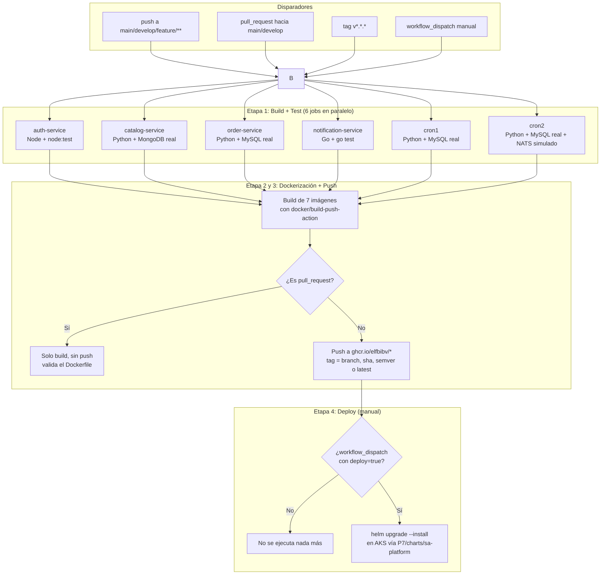

# Práctica 7 - Integración y despliegue continuo (CI/CD)

Esta carpeta contiene el pipeline de CI/CD construido con **GitHub Actions**, aplicado sobre una copia propia de la plataforma de microservicios originada en la práctica 5 (igual que la práctica 6 trabajó sobre su propia copia del chart de Helm, sin tocar `/P5`). El pipeline vive en [`/.github/workflows/ci-cd.yml`](../.github/workflows/ci-cd.yml) (GitHub solo reconoce workflows ubicados en esa ruta exacta en la raíz del repositorio) y actúa exclusivamente sobre el código copiado en `P7/api-gateway`, `P7/auth`, `P7/catalog`, `P7/orders`, `P7/notifications`, `P7/cronjobs` y sobre el chart de Helm en `P7/charts/sa-platform`. **La carpeta `/P5` no se modificó.**

## Estado actual

| Etapa | Estado | Detalle |
| --- | --- | --- |
| Build + Test | **Configurado y probado en local** | 6 jobs, uno por servicio, con bases de datos reales (MySQL/MongoDB) como contenedores de servicio. Validado localmente con Docker antes de confiar en la CI (ver [`pasos_hechos.md`](pasos_hechos.md)). |
| Dockerización + Push a GHCR | **Configurado, listo para ejecutarse** | Construye las 7 imágenes y las publica en `ghcr.io/elfbibv/*` usando el `GITHUB_TOKEN` (no requiere secrets nuevos). |
| Despliegue a AKS | **Configurado pero apagado a propósito** | El clúster de la práctica 6 fue eliminado para no seguir consumiendo el crédito de Azure. El job existe y está listo, pero solo se activa manualmente (`workflow_dispatch`) y solo hace algo una vez que se agregan los secrets de Azure descritos abajo. |

Esto fue una decisión explícita: primero validar que el CI (build + test + dockerización) funciona de punta a punta usando **únicamente runners gratuitos de GitHub**, sin tocar Azure. El despliegue real a AKS se activa cuando se decida crear un clúster nuevo.

## Arquitectura del pipeline

## Servicios cubiertos y tipo de prueba

| Servicio | Lenguaje | Cómo se prueba en CI | Dependencias reales usadas |
| --- | --- | --- | --- |
| `auth-service` | Node.js/TypeScript | `node:test` sobre funciones puras de cifrado AES, hashing bcrypt y JWT | Ninguna (pruebas unitarias puras) |
| `catalog-service` | Python/FastAPI | `pytest` + `TestClient` contra la API GraphQL real | Contenedor de servicio `mongo:6` |
| `order-service` | Python/FastAPI | `pytest` + `TestClient`; la llamada HTTP a catalog y la publicación en NATS se simulan, el resto (INSERT/SELECT) corre contra MySQL real | Contenedor de servicio `mysql:8.0` |
| `notification-service` | Go | `go vet` + `go test` sobre los handlers HTTP | Ninguna |
| `cron1` | Python | `pytest` ejecuta el script real y verifica el registro insertado | Contenedor de servicio `mysql:8.0` |
| `cron2` | Python | `pytest` ejecuta el script real contra MySQL; NATS se simula | Contenedor de servicio `mysql:8.0` |
| `api-gateway` | Nginx | Solo se construye la imagen (es un `nginx.conf` estático, no tiene lógica que probar) | — |

Los "contenedores de servicio" (`services:` en el workflow) son bases de datos reales, efímeras, que GitHub Actions levanta gratis para el runner del job y destruye al terminar. No es una simulación: las pruebas de `catalog-service`, `order-service`, `cron1` y `cron2` insertan y leen datos de verdad.

## Disparadores y estrategia de versionamiento de imágenes

| Evento | Qué corre |
| --- | --- |
| `push` a `feature/**` | Build + Test de los 6 servicios, luego build+push de las imágenes con tag = nombre de rama y sha corto (ej. `feature-Practica7`, `a1b2c3d`) |
| `push` a `develop` o `main` | Igual que arriba; además, si es `main`, agrega el tag `latest` |
| `push` de un tag `vX.Y.Z` | Igual, y adicionalmente etiqueta la imagen con esa versión semántica |
| `pull_request` hacia `main`/`develop` | Build + Test + build de Docker **sin publicar** (valida que el `Dockerfile` compila antes de aceptar el PR) |
| `workflow_dispatch` con `deploy=true` | Todo lo anterior, y al final ejecuta el job de despliegue a AKS |

Nunca se sobreescribe el tag `v1.0.0` que ya usan los `values-azure.yaml` de P6/P7 a menos que explícitamente se cree ese mismo tag de git.

## Permisos y secrets necesarios en GitHub

### Para que Build + Test + Push a GHCR funcionen (ya se puede probar hoy)

1. El workflow ya declara `permissions: packages: write`, así que en la mayoría de los casos no hay que tocar nada. Si el job `build-and-push` falla con `403 Forbidden` al hacer push a GHCR, revisar:
   **Settings → Actions → General → Workflow permissions** → seleccionar **"Read and write permissions"**.
2. No se necesita ninguna cuenta de DockerHub ni credenciales adicionales: el push a GHCR usa el `GITHUB_TOKEN` que GitHub genera automáticamente en cada ejecución.
3. Los paquetes se crean como privados bajo `ghcr.io/elfbibv/*` (igual que en P6). La primera vez que un paquete se publica desde un workflow queda vinculado automáticamente al repositorio.

### Para activar el despliegue a AKS más adelante (NO configurar todavía)

Cuando se cree un clúster nuevo, agregar:

| Tipo | Nombre | Contenido |
| --- | --- | --- |
| Secret | `AZURE_CREDENTIALS` | JSON de un service principal con permisos sobre el resource group del clúster. Se genera con `az ad sp create-for-rbac --name sa-p7-cicd --role Contributor --scopes /subscriptions/<ID_SUSCRIPCION>/resourceGroups/<RESOURCE_GROUP> --sdk-auth` |
| Secret | `GHCR_PAT` | Personal Access Token (classic) con el scope `read:packages`, usado para crear el `imagePullSecret` dentro del clúster. Se usa un PAT y no el `GITHUB_TOKEN` porque este último expira apenas termina el workflow, y el clúster necesita poder re-descargar las imágenes después |
| Variable (repo) | `AZURE_RESOURCE_GROUP` | Nombre del resource group del nuevo clúster (ej. `rg-practica7`) |
| Variable (repo) | `AZURE_AKS_CLUSTER` | Nombre del nuevo clúster AKS |
| Environment | `production-aks` | Opcional pero recomendado: crear un *environment* en **Settings → Environments** con un "required reviewer" para que el job de deploy pida aprobación manual incluso si alguien dispara el workflow por error |

Mientras estos secrets no existan, el job `deploy-to-aks` puede dispararse manualmente sin ningún riesgo: fallará de forma controlada en el paso de login de Azure porque no encontrará credenciales válidas.

## Cómo ejecutar cada etapa

- **Probar Build + Test + Dockerización (recomendado ahora):** hacer push a esta rama o abrir un Pull Request. El workflow corre solo, no consume Azure y no requiere ninguna acción adicional.
- **Activar el despliegue (cuando exista un clúster):** ir a la pestaña **Actions → CI/CD - Plataforma de Microservicios (Practica 7) → Run workflow**, marcar el checkbox `deploy` y ejecutar.

## Documentación técnica del flujo

1. **Trigger:** cualquier `push`/`pull_request` dispara los 6 jobs de prueba en paralelo; cada uno instala solo las dependencias de su propio servicio (aislamiento por lenguaje).
2. **Build + Test:** valida que el código compila (TypeScript, Go) y que la lógica de negocio funciona contra una base de datos real, no contra mocks completos. Esto detecta errores de queries SQL, de esquemas de Mongo o de serialización que un mock no vería.
3. **Dockerización:** una vez que las 6 pruebas pasan, se construyen las 7 imágenes (`docker/build-push-action` con caché de capas vía GitHub Actions cache) y se etiquetan según la rama/tag/commit.
4. **Push a GHCR:** en cualquier evento que no sea un Pull Request, las imágenes se publican en `ghcr.io/elfbibv/*`, listas para ser referenciadas por un despliegue.
5. **Deploy (manual):** hace login en Azure, obtiene las credenciales del clúster, actualiza el `imagePullSecret`, y corre `helm upgrade --install` sobre `P7/charts/sa-platform` con `values-azure.yaml`, sobreescribiendo el tag de cada imagen con el commit corto que disparó el workflow.

## Evidencia de ejecución

Pendiente: se agregará una captura de una ejecución exitosa de "Build + Test + Dockerización" en la pestaña **Actions** una vez que el workflow corra en GitHub (todavía no se ha hecho push de esta rama al remoto). El job de deploy quedará documentado con captura solo cuando exista un clúster de AKS nuevamente.

## Referencias

- [Documentación oficial de GitHub Actions](https://docs.github.com/actions)
- [GitHub Container Registry (GHCR)](https://docs.github.com/packages/working-with-a-github-packages-registry/working-with-the-container-registry)
- [docker/build-push-action](https://github.com/docker/build-push-action)
- [Service containers en GitHub Actions](https://docs.github.com/actions/using-containerized-services/about-service-containers)
- [azure/login (GitHub Action)](https://github.com/Azure/login)
