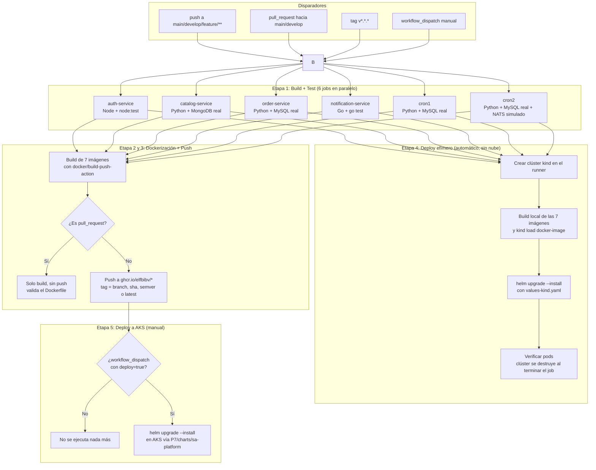

# Práctica 7 - Integración y despliegue continuo (CI/CD)

Esta carpeta contiene el pipeline de CI/CD construido con **GitHub Actions**, aplicado sobre una copia propia de la plataforma de microservicios originada en la práctica 5 (igual que la práctica 6 trabajó sobre su propia copia del chart de Helm, sin tocar `/P5`). El pipeline vive en [`/.github/workflows/ci-cd.yml`](../.github/workflows/ci-cd.yml) (GitHub solo reconoce workflows ubicados en esa ruta exacta en la raíz del repositorio) y actúa exclusivamente sobre el código copiado en `P7/api-gateway`, `P7/auth`, `P7/catalog`, `P7/orders`, `P7/notifications`, `P7/cronjobs` y sobre el chart de Helm en `P7/charts/sa-platform`. **La carpeta `/P5` no se modificó.**

## Estado actual

| Etapa | Estado | Detalle |
| --- | --- | --- |
| Build + Test | **Verificado en GitHub Actions** | 6 jobs, uno por servicio, con bases de datos reales (MySQL/MongoDB) como contenedores de servicio. Corrieron en verde en `main`, `develop` y `feature/Practica7`. |
| Dockerización + Push a GHCR | **Verificado en GitHub Actions** | Las 7 imágenes se construyen y publican en `ghcr.io/elfbibv/*` sin errores. |
| Despliegue efímero en **kind** | **Automático, corre en cada push/PR** | El job `deploy-kind` crea un clúster real de Kubernetes (temporal) dentro del propio runner, sin ninguna nube ni credenciales, y aplica el mismo chart de Helm. Sirve para validar el chart y los manifiestos en cada cambio, sin depender de Azure. |
| Despliegue a AKS | **Verificado** | Clúster `aks-sa-p7` (resource group `rg-practica7`) creado y desplegado con `helm upgrade --install` vía el job manual `deploy-to-aks`. Los 16 pods esperados (5 microservicios x 2 réplicas, `mysql-0`, `mongodb-0`, `nats-0`, y los CronJobs) quedaron en `Running`/`Completed`. |

Se validó el pipeline completo de punta a punta: build, test, dockerización, push a GHCR, despliegue efímero automático en kind, y despliegue real a AKS.

## Arquitectura del pipeline



## Servicios cubiertos y tipo de prueba

| Servicio | Lenguaje | Cómo se prueba en CI | Dependencias reales usadas |
| --- | --- | --- | --- |
| `auth-service` | Node.js/TypeScript | `node:test` sobre funciones puras de cifrado AES, hashing bcrypt y JWT | Ninguna (pruebas unitarias puras) |
| `catalog-service` | Python/FastAPI | `pytest` + `TestClient` contra la API GraphQL real | Contenedor de servicio `mongo:6` |
| `order-service` | Python/FastAPI | `pytest` + `TestClient`; la llamada HTTP a catalog y la publicación en NATS se simulan, el resto (INSERT/SELECT) corre contra MySQL real | Contenedor de servicio `mysql:8.0` |
| `notification-service` | Go | `go vet` + `go test` sobre los handlers HTTP | Ninguna |
| `cron1` | Python | `pytest` ejecuta el script real y verifica el registro insertado | Contenedor de servicio `mysql:8.0` |
| `cron2` | Python | `pytest` ejecuta el script real contra MySQL; NATS se simula | Contenedor de servicio `mysql:8.0` |
| `api-gateway` | Nginx | Solo se construye la imagen (es un `nginx.conf` estático, no tiene lógica que probar) | — |

Los "contenedores de servicio" (`services:` en el workflow) son bases de datos reales, efímeras, que GitHub Actions levanta gratis para el runner del job y destruye al terminar. No es una simulación: las pruebas de `catalog-service`, `order-service`, `cron1` y `cron2` insertan y leen datos de verdad.

## Disparadores y estrategia de versionamiento de imágenes

| Evento | Qué corre |
| --- | --- |
| `push` a `feature/**` | Build + Test de los 6 servicios, luego build+push de las imágenes con tag = nombre de rama y sha corto (ej. `feature-Practica7`, `a1b2c3d`) |
| `push` a `develop` o `main` | Igual que arriba; además, si es `main`, agrega el tag `latest` |
| `push` de un tag `vX.Y.Z` | Igual, y adicionalmente etiqueta la imagen con esa versión semántica |
| `pull_request` hacia `main`/`develop` | Build + Test + build de Docker **sin publicar** (valida que el `Dockerfile` compila antes de aceptar el PR) |
| `workflow_dispatch` con `deploy=true` | Todo lo anterior, y al final ejecuta el job de despliegue a AKS |

Nunca se sobreescribe el tag `v1.0.0` que ya usan los `values-azure.yaml` de P6/P7 a menos que explícitamente se cree ese mismo tag de git.

## Permisos y secrets necesarios en GitHub

### Para que Build + Test + Push a GHCR funcionen

1. El workflow ya declara `permissions: packages: write`, así que en la mayoría de los casos no hay que tocar nada. Si el job `build-and-push` falla con `403 Forbidden` al hacer push a GHCR, revisar:
   **Settings → Actions → General → Workflow permissions** → seleccionar **"Read and write permissions"**.
2. No se necesita ninguna cuenta de DockerHub ni credenciales adicionales: el push a GHCR usa el `GITHUB_TOKEN` que GitHub genera automáticamente en cada ejecución.
3. **Paso obligatorio detectado en la primera ejecución real:** los 7 paquetes (`sa-api-gateway`, `sa-auth-service`, `sa-catalog-service`, `sa-order-service`, `sa-notification-service`, `sa-cron1`, `sa-cron2`) ya existían en GHCR desde P5/P6, publicados con un token personal en vez de por un workflow de Actions. GitHub **no** conecta automáticamente un paquete pre-existente al repositorio; hay que hacerlo a mano una sola vez por paquete:
   - Ir a `https://github.com/users/ELFBIBv/packages/container/<nombre-del-paquete>/settings`.
   - En **"Manage Actions access"** → **Add Repository** → buscar `Practicas-SA-B-202203856` → asignarle el rol **Write**.
   - Repetir para los 7 paquetes.
   - Si un paquete todavía no existe (se crea por primera vez desde este workflow), este paso no es necesario: queda vinculado automáticamente.

### Para activar el despliegue a AKS

Ya configurado y verificado en este repositorio:

| Tipo | Nombre | Contenido |
| --- | --- | --- |
| Secret | `AZURE_CREDENTIALS` | JSON de un service principal con permisos sobre el resource group del clúster. Se genera con `az ad sp create-for-rbac --name sa-p7-cicd --role Contributor --scopes /subscriptions/<ID_SUSCRIPCION>/resourceGroups/<RESOURCE_GROUP> --sdk-auth` |
| Secret | `GHCR_PAT` | Personal Access Token (classic) con el scope `read:packages`, usado para crear el `imagePullSecret` dentro del clúster. Se usa un PAT y no el `GITHUB_TOKEN` porque este último expira apenas termina el workflow, y el clúster necesita poder re-descargar las imágenes después |
| Variable (repo) | `AZURE_RESOURCE_GROUP` | `rg-practica7` |
| Variable (repo) | `AZURE_AKS_CLUSTER` | `aks-sa-p7` |
| Environment | `production-aks` | Opcional pero recomendado: crear un *environment* en **Settings → Environments** con un "required reviewer" para que el job de deploy pida aprobación manual incluso si alguien dispara el workflow por error |

Si se elimina el clúster y se necesita recrearlo con otro nombre, estos mismos secrets/variables deben actualizarse. Sin credenciales válidas, el job `deploy-to-aks` falla de forma controlada en el paso de login de Azure, sin riesgo.

## Procedimiento para crear el clúster de AKS de esta práctica

Mismo procedimiento que en `P6/README.md`, adaptado con nombres propios de P7 para no confundirlo con el clúster ya eliminado de la práctica anterior. **Cada paso de aquí en adelante genera costo real por hora en Azure hasta que el resource group se elimine.**

### 1. Variables y sesión de Azure

```bash
export RESOURCE_GROUP="rg-practica7"
export AKS_CLUSTER="aks-sa-p7"
export LOCATION="chilecentral"
export NAMESPACE="sa-p5"
export RELEASE="sa-platform"

az login
az account set --subscription "Azure for Students"
az vm list-usage --location "$LOCATION" --output table
```

Revisar la cuota antes de crear el clúster, igual que en P6.

### 2. Crear el resource group y el clúster AKS

```bash
az group create --name "$RESOURCE_GROUP" --location "$LOCATION"

az aks create \
  --resource-group "$RESOURCE_GROUP" \
  --name "$AKS_CLUSTER" \
  --location "$LOCATION" \
  --tier free \
  --node-count 2 \
  --node-vm-size Standard_DS2_v2 \
  --network-plugin azure \
  --network-plugin-mode overlay \
  --network-dataplane cilium \
  --generate-ssh-keys

az aks get-credentials \
  --resource-group "$RESOURCE_GROUP" \
  --name "$AKS_CLUSTER" \
  --overwrite-existing

kubectl get nodes
```

### 3. Crear el Service Principal para el secret `AZURE_CREDENTIALS`

```bash
SUBSCRIPTION_ID=$(az account show --query id -o tsv)

az ad sp create-for-rbac \
  --name "sa-p7-cicd" \
  --role Contributor \
  --scopes "/subscriptions/$SUBSCRIPTION_ID/resourceGroups/$RESOURCE_GROUP" \
  --sdk-auth
```

Esto imprime un JSON. Ese JSON completo (tal cual) es el valor del secret `AZURE_CREDENTIALS`.

### 4. Generar el `GHCR_PAT`

En GitHub: **Settings (de tu cuenta) → Developer settings → Personal access tokens → Tokens (classic) → Generate new token**, con el scope `read:packages` únicamente. Copiar el valor (solo se muestra una vez).

### 5. Cargar los secrets y variables en el repositorio

Por la interfaz (**Settings → Secrets and variables → Actions** del repositorio) o con `gh` CLI. Para los dos secrets, la forma más simple es guardar el valor en un archivo temporal y redirigirlo (evita tener que "pegar y Ctrl+D" en la terminal):

```bash
# AZURE_CREDENTIALS: guarda el JSON del paso 3 en un archivo, súbelo, y bórralo
nano azure-creds.json          # pega el JSON, guarda (Ctrl+O, Enter) y sal (Ctrl+X)
gh secret set AZURE_CREDENTIALS < azure-creds.json
rm azure-creds.json            # nunca debe quedar ni commitearse este archivo

# GHCR_PAT: es una sola línea, se puede pasar directo
echo "TU_TOKEN_AQUI" | gh secret set GHCR_PAT

gh variable set AZURE_RESOURCE_GROUP --body "rg-practica7"
gh variable set AZURE_AKS_CLUSTER --body "aks-sa-p7"
```

Opcional pero recomendado: crear el *environment* `production-aks` en **Settings → Environments** con un "required reviewer".

### 6. Disparar el despliegue

**Actions → CI/CD - Plataforma de Microservicios (Practica 7) → Run workflow**, elegir la rama, marcar el checkbox `deploy` y ejecutar. El job `deploy-to-aks` hace login en Azure, obtiene las credenciales del clúster, crea el `imagePullSecret` de GHCR con el `GHCR_PAT`, y corre `helm upgrade --install` sobre `P7/charts/sa-platform` con `values-azure.yaml`.

> **Requisito no obvio:** el botón "Run workflow" (y el disparo manual en general) **solo aparece si `.github/workflows/ci-cd.yml` ya existe en la rama por defecto del repositorio** (`main`), sin importar en qué rama se quiera correr el deploy después. Si se recrea este proyecto en un repositorio nuevo y se desarrolla todo en una rama `feature/...`, hay que mergear esa rama hacia `main` al menos una vez antes de que GitHub habilite el disparo manual — es una restricción de la plataforma, no de este workflow en particular.

### 7. Verificar y, cuando termines, eliminar el clúster

```bash
kubectl get pods -n "$NAMESPACE"
kubectl get service sa-platform-api-gateway -n "$NAMESPACE"

# Cuando ya no se necesite (para no seguir generando costo):
az group delete --name "$RESOURCE_GROUP" --yes --no-wait
```
## Cómo ejecutar cada etapa

- **Build + Test + Dockerización + Deploy efímero en kind:** se disparan solos con cualquier `push` o `pull_request`, sin acción adicional ni credenciales de ningún tipo.
- **Activar el despliegue real a AKS:** pestaña **Actions → CI/CD - Plataforma de Microservicios (Practica 7) → Run workflow**, marcar el checkbox `deploy` y ejecutar. Requiere que exista el clúster de AKS y los secrets/variables de la sección anterior.

## Documentación técnica del flujo

1. **Trigger:** cualquier `push`/`pull_request` dispara los 6 jobs de prueba en paralelo; cada uno instala solo las dependencias de su propio servicio (aislamiento por lenguaje).
2. **Build + Test:** valida que el código compila (TypeScript, Go) y que la lógica de negocio funciona contra una base de datos real, no contra mocks completos. Esto detecta errores de queries SQL, de esquemas de Mongo o de serialización que un mock no vería.
3. **Dockerización:** una vez que las 6 pruebas pasan, se construyen las 7 imágenes (`docker/build-push-action` con caché de capas vía GitHub Actions cache) y se etiquetan según la rama/tag/commit.
4. **Push a GHCR:** en cualquier evento que no sea un Pull Request, las imágenes se publican en `ghcr.io/elfbibv/*`, listas para ser referenciadas por un despliegue.
5. **Deploy efímero en kind (automático):** en paralelo al build+push, el job `deploy-kind` construye las mismas 7 imágenes en local (sin publicarlas a ningún registry), crea un clúster real de Kubernetes con [`kind`](https://kind.sigs.k8s.io/) dentro del propio runner, carga ahí las imágenes con `kind load docker-image`, y aplica el chart completo (`helm upgrade --install` con `values.yaml` + `values-dev.yaml` + `values-kind.yaml`). Verifica que todos los pods, PVCs, Services y CronJobs se creen correctamente. El clúster se destruye automáticamente al terminar el job (la acción `helm/kind-action` lo limpia). Esto prueba que el chart de Helm funciona de verdad, en cada cambio, sin depender de Azure ni de ningún secret.
6. **Deploy real a AKS (manual):** hace login en Azure, obtiene las credenciales del clúster, actualiza el `imagePullSecret`, y corre `helm upgrade --install` sobre `P7/charts/sa-platform` con `values-azure.yaml`, sobreescribiendo el tag de cada imagen con el commit corto que disparó el workflow.

## Evidencia de ejecución

**1. Ejecución completa del pipeline en verde** (6 jobs de test, 7 de `build-and-push`, y `Deploy a AKS` — run manual `#6`, disparado con `deploy=true` sobre `main`):


**2. Pods corriendo en el clúster AKS** (`kubectl get pods -n sa-p5`): los 5 microservicios con 2 réplicas cada uno, `mysql-0`/`mongodb-0`/`nats-0`, y los CronJobs ya ejecutados (`Completed`):


**3. Servicio expuesto públicamente** (`kubectl get service sa-platform-api-gateway -n sa-p5`), con la IP externa asignada por el Load Balancer de Azure:


**4. Verificación independiente desde Azure Cloud Shell** (otra terminal, distinta a la máquina local usada en las capturas anteriores): `az aks get-credentials` + `kubectl get pods -n sa-p5` confirmando los mismos pods `Running`/`Completed`:


## Referencias

- [Documentación oficial de GitHub Actions](https://docs.github.com/actions)
- [GitHub Container Registry (GHCR)](https://docs.github.com/packages/working-with-a-github-packages-registry/working-with-the-container-registry)
- [docker/build-push-action](https://github.com/docker/build-push-action)
- [Service containers en GitHub Actions](https://docs.github.com/actions/using-containerized-services/about-service-containers)
- [azure/login (GitHub Action)](https://github.com/Azure/login)
- [kind (Kubernetes IN Docker)](https://kind.sigs.k8s.io/)
- [helm/kind-action](https://github.com/helm/kind-action)

