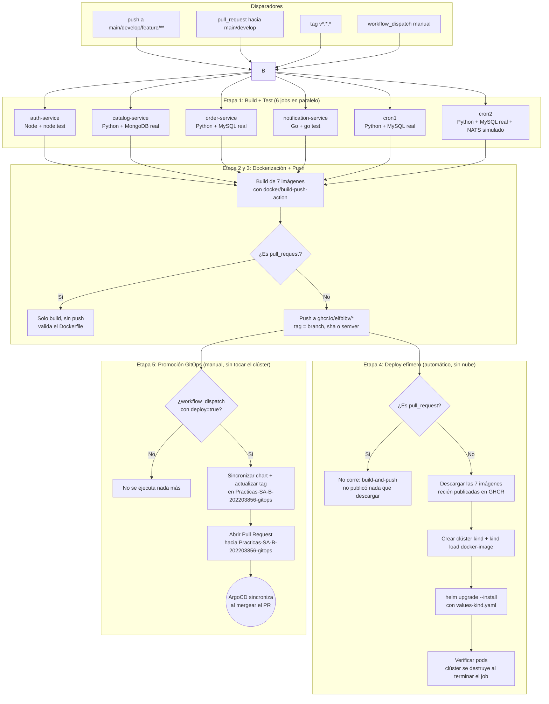
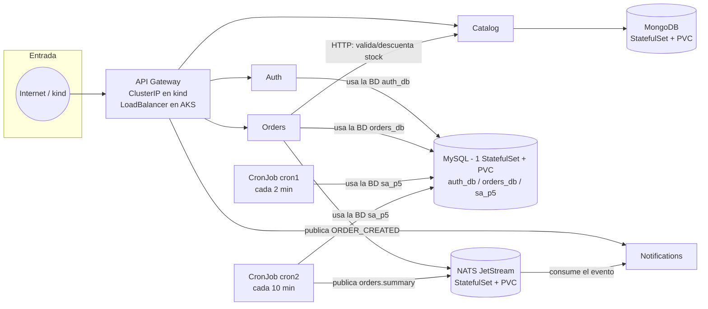
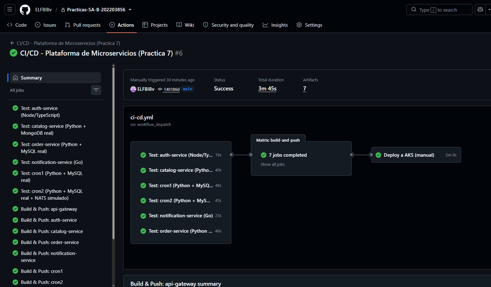
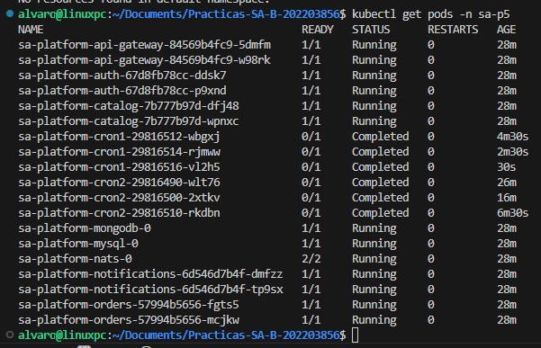
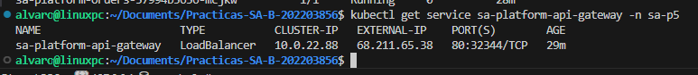
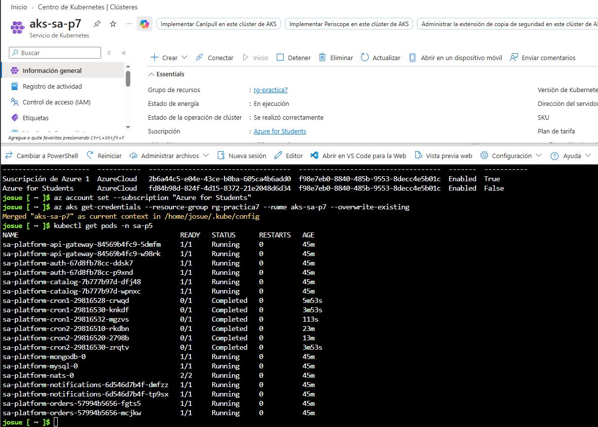

# Práctica 8 - GitOps, entrega progresiva y seguridad de la cadena de suministro

Esta carpeta contiene el pipeline de CI/CD construido con **GitHub Actions**, aplicado sobre una copia propia de la plataforma de microservicios originada en la práctica 5 (igual que la práctica 6 trabajó sobre su propia copia del chart de Helm, sin tocar `/P5`). El pipeline vive en [`/.github/workflows/ci-cd.yml`](../.github/workflows/ci-cd.yml) (GitHub solo reconoce workflows ubicados en esa ruta exacta en la raíz del repositorio) y actúa exclusivamente sobre el código copiado en `P8/api-gateway`, `P8/auth`, `P8/catalog`, `P8/orders`, `P8/notifications`, `P8/cronjobs` y sobre el chart de Helm en `P8/charts/sa-platform`. **La carpeta `/P5` no se modificó.**

> **Estado de la entrega:** este README todavía no cumple con el formato de entrega exigido por el enunciado (`Practica_8_2S2026.md`, sección 4.1). Las secciones de arquitectura y procedimientos de abajo siguen describiendo en buena parte el pipeline heredado de la Práctica 7. Lo que ya está implementado (ver [`CAMBIOS-GITOPS.md`](CAMBIOS-GITOPS.md)): se eliminó el flujo de despliegue directo; el pipeline escanea con Trivy (bloqueante ante `CRITICAL`), genera SBOM y firma con Cosign antes de publicar cualquier imagen en GHCR; 3 políticas de admisión de Kyverno en [`P8/kyverno/policies/`](kyverno/policies/); una prueba de carga con k6 en [`P8/loadtest/`](loadtest/); el [informe de incidente](informe-incidente.md) del fallo inducido y el [diagrama del flujo](diagrama-flujo.md); el clúster `aks-sa-p8` real está levantado con el Terraform de [`P8/terraform/`](terraform/) aplicado; **ArgoCD ya está instalado y sincronizando de verdad** (`Application` `sa-platform` en `Synced`/`Healthy`, 7 servicios corriendo en `sa-p5`, gateway respondiendo en IP pública real, con capturas reales de la UI); y **Kyverno también ya está instalado en ese mismo clúster real**, con las 3 políticas probadas en ambas direcciones — incluyendo la verificación criptográfica real de la firma de Cosign de una imagen ya publicada, que en `kind` había quedado pendiente por falta de credenciales de prueba. Pendiente: migrar `ghcr-secret`/`sa-platform-nats-auth` a Sealed Secrets (hoy son secretos planos creados a mano), disparar el pipeline completo con `workflow_dispatch` para que el PR al repo GitOps sea el que dispare el próximo sync en vivo (ya se probó una vez antes de esta sesión, PR #2, pero sin todo lo agregado después), video, y completar las filas que faltan abajo.

## Tabla de enlaces obligatoria (sección 4.1 del enunciado)

| Ítem | Enlace o dato requerido |
| --- | --- |
| Repositorio GitOps | https://github.com/ELFBIBv/Practicas-SA-B-202203856-gitops |
| Aplicación en ArgoCD | `sa-platform`, namespace `argocd` (destino: namespace `sa-p5` del clúster `aks-sa-p8`) — `Synced`/`Healthy`. Capturas reales: [estado actual](evidencia/argocd-sync.png) y [historial de sincronizaciones](evidencia/argocd-historial.png) (sync automático, `automated sync policy`, 1m35s). Detalle en `CAMBIOS-GITOPS.md`, Fase 8. |
| Ejecución exitosa del pipeline | https://github.com/ELFBIBv/Practicas-SA-B-202203856/actions/runs/35374724033 (todos los jobs en verde, incluyendo Kyverno y k6) + [PR #2 al repo GitOps](https://github.com/ELFBIBv/Practicas-SA-B-202203856-gitops/pull/2), abierto y mergeado automáticamente por el job `promote-to-gitops` — evidencia real de que el mecanismo CI→PR→merge funciona de punta a punta. PENDIENTE una corrida fresca con `workflow_dispatch` que incluya todo lo agregado después (Kyverno, k6, informe) y que ArgoCD la sincronice en vivo. |
| Reversión automática | Run: https://github.com/ELFBIBv/Practicas-SA-B-202203856/actions/runs/35374724033/job/105697632563 — Rollout `sa-platform-api-gateway`, revisión 3 abortada automáticamente (`Status: ✖ Degraded`, canary escalado a 0 réplicas). Detalle completo en [`informe-incidente.md`](informe-incidente.md). Corresponde al `kind` efímero del pipeline, no a AKS todavía. |
| Despliegue rechazado por política | **Contra el clúster AKS real** (`aks-sa-p8`): `kubectl run policy-check-external-image --image=nginx:latest` rechazado por `restrict-image-registries` + `require-non-root-user`. Y el camino permitido, también verificado ahí: una imagen real firmada (`ghcr.io/elfbibv/sa-api-gateway@sha256:0d4942874e...`) fue **admitida** tras verificar su firma de Cosign de verdad (`verify-image-signatures`). Detalle completo en `CAMBIOS-GITOPS.md`, Fase 9. (Evidencia adicional del mismo rechazo en el `kind` efímero de CI: https://github.com/ELFBIBv/Practicas-SA-B-202203856/actions/runs/35374724033/job/105697632485) |
| Bloqueo por vulnerabilidad crítica | PR bloqueado: https://github.com/ELFBIBv/Practicas-SA-B-202203856/pull/1 — job fallido (3 CVE CRITICAL en `api-gateway`, ver también otros 5 servicios bloqueados en el mismo PR): https://github.com/ELFBIBv/Practicas-SA-B-202203856/actions/runs/35315634021/job/105506751987?pr=1 |
| Imagen firmada | `ghcr.io/elfbibv/sa-api-gateway@sha256:0d4942874e02de72c2092a554fba5ed3e1da8b1331091c38ccb3a8bc262b9763` — firmada con Cosign (keyless/OIDC) en https://github.com/ELFBIBv/Practicas-SA-B-202203856/actions/runs/35374724033/job/105696917236 |
| Reporte de prueba de carga | Script: [`P8/loadtest/api-gateway-load-test.js`](loadtest/api-gateway-load-test.js). Corrida real en verde: https://github.com/ELFBIBv/Practicas-SA-B-202203856/actions/runs/35374724033/job/105697632524 (reporte JSON subido como artifact de ese job). |
| Video demostrativo | PENDIENTE |

## Estado actual

| Etapa | Estado | Detalle |
| --- | --- | --- |
| Build + Test | **Verificado en GitHub Actions** | 6 jobs, uno por servicio, con bases de datos reales (MySQL/MongoDB) como contenedores de servicio. Corrieron en verde en `main`, `develop` y `feature/Practica8`. |
| Dockerización + Push a GHCR | **Verificado en GitHub Actions** | Las 7 imágenes se construyen y publican en `ghcr.io/elfbibv/*` sin errores. |
| Despliegue efímero en **kind** | **Automático, corre después de cada push (no en PR)** | El job `deploy-kind` descarga las 7 imágenes recién publicadas en GHCR (las mismas que se acaban de subir, no una copia reconstruida aparte), crea un clúster real de Kubernetes (temporal) dentro del propio runner, y aplica el mismo chart de Helm. Sirve para validar el chart y los manifiestos en cada cambio, sin depender de Azure. |
| Despliegue a AKS | **Verificado, vía ArgoCD real** | Clúster `aks-sa-p8`/`rg-practica8`, Terraform aplicado, ArgoCD instalado y sincronizando la `Application` `sa-platform` (`Synced`/`Healthy`). Los 7 servicios corren en `sa-p5`, el gateway responde en una IP pública real. Falta Sealed Secrets (ver [`CAMBIOS-GITOPS.md`](CAMBIOS-GITOPS.md), Fase 8). |
| Kyverno en AKS | **Verificado contra el clúster real** | Las 3 políticas de [`P8/kyverno/policies/`](kyverno/policies/) instaladas y probadas en `aks-sa-p8`: rechazo real confirmado, y también el camino permitido (una imagen firmada de verdad fue admitida tras verificar su firma de Cosign). Ver [`CAMBIOS-GITOPS.md`](CAMBIOS-GITOPS.md), Fase 9. |

Se validó de punta a punta: build, test, dockerización, push a GHCR, despliegue efímero automático en kind, **y ahora también el despliegue real a AKS vía ArgoCD y las políticas de Kyverno contra ese mismo clúster**, todo sincronizado y saludable.

## Arquitectura del pipeline



Este diagrama de arriba muestra el **proceso** del pipeline (los pasos de GitHub Actions). El job `promote-to-gitops` (Etapa 5) no tiene credenciales de Azure ni acceso al clúster: solo abre un PR en el repositorio [`Practicas-SA-B-202203856-gitops`](https://github.com/ELFBIBv/Practicas-SA-B-202203856-gitops). Quien realmente aplica el cambio es ArgoCD, todavía pendiente de instalar (ver [`CAMBIOS-GITOPS.md`](CAMBIOS-GITOPS.md)). El siguiente diagrama muestra algo distinto: la **arquitectura que queda corriendo dentro del clúster** una vez aplicado el chart — es la misma topología tanto en `kind` (Etapa 4, vía `helm upgrade --install` efímero dentro del job) como en AKS (vía ArgoCD), solo cambia dónde vive el clúster y cuántas réplicas tiene cada servicio (`values-kind.yaml` usa 1 réplica por servicio para caber en el runner; `values-azure.yaml` usa 2).

## Arquitectura de despliegue (qué corre dentro del clúster)



Namespace `sa-p5` para ambos entornos. Los servicios internos (`Auth`, `Catalog`, `Orders`, `Notifications`, bases de datos) son siempre `ClusterIP`, solo accesibles dentro del clúster; únicamente el `API Gateway` se expone hacia afuera (en `kind` no hace falta exponerlo porque la verificación se hace con `kubectl`/`port-forward` dentro del mismo job; en AKS se expone con IP pública real vía `Service` tipo `LoadBalancer`, como se documentó en la evidencia de ejecución).

**Sobre las 4 flechas hacia MySQL:** no es una base de datos compartida entre servicios. Es **un solo servidor MySQL** (un Pod, un PVC) que aloja **tres bases de datos separadas**: `auth_db` (usada solo por Auth), `orders_db` (usada solo por Orders) y `sa_p5` (usada por ambos CronJobs para su tabla `cron_logs`). Cada servicio tiene sus propias credenciales y su propio `DB_NAME`, definidos en su respectivo `ConfigMap` (`charts/auth/templates/configmap.yaml`, `charts/orders/templates/configmap.yaml`, `templates/cronjobs-configmaps.yaml`); solo comparten el motor de base de datos para ahorrar recursos, no las tablas.

## Servicios cubiertos y tipo de prueba

| Servicio | Lenguaje | Cómo se prueba en CI | Dependencias reales usadas |
| --- | --- | --- | --- |
| `auth-service` | Node.js/TypeScript | `node:test` sobre funciones puras de cifrado AES, hashing bcrypt y JWT | Ninguna (pruebas unitarias puras) |
| `catalog-service` | Python/FastAPI | `pytest` + `TestClient` contra la API GraphQL real | Contenedor de servicio `mongo:6` |
| `order-service` | Python/FastAPI | `pytest` + `TestClient`; la llamada HTTP a catalog y la publicación en NATS se simulan, el resto (INSERT/SELECT) corre contra MySQL real | Contenedor de servicio `mysql:8.0` |
| `notification-service` | Go | `go vet` + `go test` sobre los handlers HTTP | Ninguna |
| `cron1` | Python | `pytest` ejecuta el script real y verifica el registro insertado | Contenedor de servicio `mysql:8.0` |
| `cron2` | Python | `pytest` ejecuta el script real contra MySQL; NATS se simula | Contenedor de servicio `mysql:8.0` |
| `api-gateway` | Nginx | Solo se construye la imagen (es un `nginx.conf` estático, no tiene lógica que probar) | — |

Los "contenedores de servicio" (`services:` en el workflow) son bases de datos reales, efímeras, que GitHub Actions levanta gratis para el runner del job y destruye al terminar. No es una simulación: las pruebas de `catalog-service`, `order-service`, `cron1` y `cron2` insertan y leen datos de verdad.

## Disparadores y estrategia de versionamiento de imágenes

| Evento | Qué corre |
| --- | --- |
| `push` a `feature/**` | Build + Test de los 6 servicios, luego build+push de las imágenes con tag = nombre de rama y sha corto (ej. `feature-Practica8`, `a1b2c3d`) |
| `push` a `develop` o `main` | Igual que arriba: publica tags de rama y sha corto, sin utilizar `latest` |
| `push` de un tag `vX.Y.Z` | Igual, y adicionalmente etiqueta la imagen con esa versión semántica |
| `pull_request` hacia `main`/`develop` | Build + Test + build de Docker **sin publicar** (valida que el `Dockerfile` compila antes de aceptar el PR) |
| `workflow_dispatch` con `deploy=true` | Todo lo anterior, y al final ejecuta el job de despliegue a AKS |

Las imágenes usadas como baseline local tienen la versión explícita `v8.0.0`; las versiones semánticas publicadas en GHCR únicamente se crean desde un tag Git `vX.Y.Z`.

## Permisos y secrets necesarios en GitHub

### Para que Build + Test + Push a GHCR funcionen

1. El workflow ya declara `permissions: packages: write`, así que en la mayoría de los casos no hay que tocar nada. Si el job `build-and-push` falla con `403 Forbidden` al hacer push a GHCR, revisar:
   **Settings → Actions → General → Workflow permissions** → seleccionar **"Read and write permissions"**.
2. No se necesita ninguna cuenta de DockerHub ni credenciales adicionales: el push a GHCR usa el `GITHUB_TOKEN` que GitHub genera automáticamente en cada ejecución.
3. **Paso obligatorio detectado en la primera ejecución real:** los 7 paquetes (`sa-api-gateway`, `sa-auth-service`, `sa-catalog-service`, `sa-order-service`, `sa-notification-service`, `sa-cron1`, `sa-cron2`) ya existían en GHCR desde P5/P6, publicados con un token personal en vez de por un workflow de Actions. GitHub **no** conecta automáticamente un paquete pre-existente al repositorio; hay que hacerlo a mano una sola vez por paquete:
   - Ir a `https://github.com/users/ELFBIBv/packages/container/<nombre-del-paquete>/settings`.
   - En **"Manage Actions access"** → **Add Repository** → buscar `Practicas-SA-B-202203856` → asignarle el rol **Write**.
   - Repetir para los 7 paquetes.
   - Si un paquete todavía no existe (se crea por primera vez desde este workflow), este paso no es necesario: queda vinculado automáticamente.

### Para activar la promoción vía GitOps (job `promote-to-gitops`)

> **Cambio desde la Fase 1 de [`CAMBIOS-GITOPS.md`](CAMBIOS-GITOPS.md):** el pipeline ya **no** se conecta a Azure ni al clúster. `AZURE_CREDENTIALS`, `GHCR_PAT` (para el `imagePullSecret` en el clúster) y `production-aks` dejaron de ser necesarios como secrets/variables de GitHub Actions — ese trabajo ahora lo hace ArgoCD dentro del clúster, no el pipeline.

| Tipo | Nombre | Contenido |
| --- | --- | --- |
| Secret | `GITOPS_PAT` | Personal Access Token (classic) con scope `repo` completo, con permiso de escritura sobre [`ELFBIBv/Practicas-SA-B-202203856-gitops`](https://github.com/ELFBIBv/Practicas-SA-B-202203856-gitops). Se usa para clonar ese repo, empujar la rama de promoción y abrir el Pull Request. Generación: GitHub → **Settings (de tu cuenta) → Developer settings → Personal access tokens → Tokens (classic) → Generate new token**, scope `repo`. Carga: `echo "TU_TOKEN_AQUI" | gh secret set GITOPS_PAT` |

Sin este secret, el job `promote-to-gitops` falla de forma controlada al intentar clonar el repo GitOps, sin riesgo para el clúster (porque ya no tiene forma de tocarlo).

### Para el bootstrap del clúster (manual, fuera de CI)

Estas credenciales ya no viven en GitHub Actions; se usan a mano, una sola vez, para crear el clúster e instalar ArgoCD (ver procedimiento más abajo). Azure se necesitará recién quien lea esta sección lo ejecute con su propia suscripción — avisar antes de correr cualquier paso que genere costo:

| Nombre | Contenido |
| --- | --- |
| `AZURE_RESOURCE_GROUP` | `rg-practica8` |
| `AZURE_AKS_CLUSTER` | `aks-sa-p8` |

## Procedimiento para crear el clúster de AKS de esta práctica

Mismo procedimiento que en `P6/README.md`, adaptado con nombres propios de P8 para no confundirlo con el clúster ya eliminado de la práctica anterior. **Cada paso de aquí en adelante genera costo real por hora en Azure hasta que el resource group se elimine.**

### 1. Variables y sesión de Azure

```bash
export RESOURCE_GROUP="rg-practica8"
export AKS_CLUSTER="aks-sa-p8"
export LOCATION="chilecentral"
export NAMESPACE="sa-p5"
export RELEASE="sa-platform"

az login
az account set --subscription "Azure for Students"
az vm list-usage --location "$LOCATION" --output table
```

Revisar la cuota antes de crear el clúster, igual que en P6.

### 2. Crear el resource group y el clúster AKS

```bash
az group create --name "$RESOURCE_GROUP" --location "$LOCATION"

az aks create \
  --resource-group "$RESOURCE_GROUP" \
  --name "$AKS_CLUSTER" \
  --location "$LOCATION" \
  --tier free \
  --node-count 2 \
  --node-vm-size Standard_DS2_v2 \
  --network-plugin azure \
  --network-plugin-mode overlay \
  --network-dataplane cilium \
  --generate-ssh-keys

az aks get-credentials \
  --resource-group "$RESOURCE_GROUP" \
  --name "$AKS_CLUSTER" \
  --overwrite-existing

kubectl get nodes
```

### 3. Aplicar Terraform: namespace, cuotas, límites y RBAC

Con el clúster ya creado (`az aks get-credentials` del paso 2 ya deja el contexto de kubectl listo), este es el primer paso declarativo — crea el namespace `sa-p5` antes de que nada más lo necesite. Detalle completo, incluyendo por qué hay dos `ResourceQuota` distintas en el mismo namespace, en [`P8/terraform/README.md`](terraform/README.md):

```bash
cd P8/terraform
cp terraform.tfvars.example terraform.tfvars   # ajustar kube_context si hace falta
terraform init
terraform plan  -out=tfplan | tee plan.log
terraform apply tfplan       | tee apply.log
kubectl get resourcequota,limitrange,sa,role,rolebinding -n sa-p5
cd ../..
```

Guardar `plan.log`, `apply.log` y la salida de ese último `kubectl get` como evidencia — van enlazados desde la tabla de enlaces obligatoria.

### 4. Crear los secretos que el chart necesita (manual, ya no vía CI)

> Desde la Fase 1 de [`CAMBIOS-GITOPS.md`](CAMBIOS-GITOPS.md), estos secretos ya no los crea el pipeline (antes lo hacía el job `deploy-to-aks`, hoy eliminado). Se crean una sola vez, a mano, contra el clúster real. Ver también la nota sobre migrarlos a Sealed Secrets/External Secrets, pendiente en el repo GitOps.

Dos secretos, por dos motivos distintos:

**`ghcr-secret`** — para que el clúster pueda bajar las imágenes privadas de GHCR. En GitHub: **Settings (de tu cuenta) → Developer settings → Personal access tokens → Tokens (classic) → Generate new token**, con el scope `read:packages` únicamente. El namespace ya lo creó Terraform en el paso anterior:

```bash
kubectl create secret docker-registry ghcr-secret \
  --namespace "$NAMESPACE" \
  --docker-server=ghcr.io \
  --docker-username="ELFBIBv" \
  --docker-password="TU_TOKEN_read:packages"
```

**`sa-platform-nats-auth`** — token de autenticación entre los pods de NATS, que `values-azure.yaml` referencia (`global.natsAuthSecretName`). No depende de ninguna cuenta externa, es solo un valor aleatorio:

```bash
kubectl create secret generic sa-platform-nats-auth \
  --namespace "$NAMESPACE" \
  --from-literal=token="$(openssl rand -hex 32)"
```

### 5. Cargar `GITOPS_PAT` en el repositorio de código

Este es el único secret que necesita el pipeline de CI hoy (ver detalle de generación en la sección "Para activar la promoción vía GitOps" más arriba):

```bash
echo "TU_TOKEN_AQUI" | gh secret set GITOPS_PAT --repo ELFBIBv/Practicas-SA-B-202203856
```

### 6. Instalar ArgoCD y aplicar la Application

Probado de punta a punta contra un clúster real — comandos reales, en el orden que realmente funciona (ver el detalle completo, incluyendo los dos problemas que aparecen si se salta algún paso, en [`CAMBIOS-GITOPS.md`](CAMBIOS-GITOPS.md), Fase 8):

```bash
# 1. ArgoCD
kubectl create namespace argocd --dry-run=client -o yaml | kubectl apply -f -
# --server-side evita el límite de 256 KB en la anotación last-applied-configuration
# que rompe con el CRD de ApplicationSet bajo un "kubectl apply" normal.
kubectl apply --server-side --force-conflicts -n argocd \
  -f https://raw.githubusercontent.com/argoproj/argo-cd/stable/manifests/install.yaml
kubectl -n argocd wait --for=condition=available --timeout=180s deployment --all

# 2. CRDs de Argo Rollouts — el chart define recursos Rollout/AnalysisTemplate;
#    sin esto, el primer sync de ArgoCD falla con "no matches for kind Rollout".
kubectl create namespace argo-rollouts --dry-run=client -o yaml | kubectl apply -f -
kubectl apply --server-side --force-conflicts -n argo-rollouts \
  -f https://github.com/argoproj/argo-rollouts/releases/latest/download/install.yaml
kubectl -n argo-rollouts wait --for=condition=available --timeout=180s deployment --all

# 3. La Application (ya existe en el repo GitOps, apunta a charts/sa-platform)
curl -sL https://raw.githubusercontent.com/ELFBIBv/Practicas-SA-B-202203856-gitops/main/argocd/application.yaml \
  | kubectl apply -f -

# 4. Verificar que sincronizó de verdad, no solo "Synced"
kubectl get application sa-platform -n argocd
for dep in $(kubectl get deployment -n "$NAMESPACE" -o jsonpath='{.items[*].metadata.name}'); do
  kubectl rollout status "deployment/$dep" -n "$NAMESPACE" --timeout=180s
done
for sts in $(kubectl get statefulset -n "$NAMESPACE" -o jsonpath='{.items[*].metadata.name}'); do
  kubectl rollout status "statefulset/$sts" -n "$NAMESPACE" --timeout=180s
done
bash P8/scripts/wait-for-rollout.sh sa-platform-api-gateway "$NAMESPACE" Healthy 180
```

Para ver la UI (`Synced`/`Healthy`, historial de sincronizaciones):

```bash
kubectl -n argocd get secret argocd-initial-admin-secret -o jsonpath='{.data.password}' | base64 -d; echo
kubectl -n argocd port-forward svc/argocd-server 8080:443
# abrir https://localhost:8080, usuario admin, la contraseña de arriba
```

### 7. Instalar Kyverno y aplicar las 3 políticas de admisión

Probado de punta a punta contra un clúster real (detalle completo, incluyendo el caso rechazado y el caso permitido con verificación de firma real, en [`CAMBIOS-GITOPS.md`](CAMBIOS-GITOPS.md), Fase 9):

```bash
helm repo add kyverno https://kyverno.github.io/kyverno/
helm repo update
helm install kyverno kyverno/kyverno -n kyverno --create-namespace --wait --timeout 180s
kubectl apply -f P8/kyverno/policies/
kubectl get clusterpolicy
```

Opcional, solo si querés que `verify-image-signatures` pueda verificar firmas de verdad (si no, la política sigue activa pero falla cerrado por falta de credenciales, que también es una demostración válida): copiar `ghcr-secret` al namespace `kyverno` y decírselo al chart:

```bash
kubectl get secret ghcr-secret -n "$NAMESPACE" -o json | \
  python3 -c "import json,sys; d=json.load(sys.stdin); d['metadata']={'name':'ghcr-secret','namespace':'kyverno'}; print(json.dumps(d))" | \
  kubectl apply -f -
helm upgrade kyverno kyverno/kyverno -n kyverno --reuse-values \
  --set existingImagePullSecrets[0]=ghcr-secret --wait --timeout 180s
```

### 8. Disparar la promoción

**Actions → CI/CD - Plataforma de Microservicios (Practica 8) → Run workflow**, elegir la rama, marcar el checkbox `deploy` y ejecutar. El job `promote-to-gitops` sincroniza el chart hacia `Practicas-SA-B-202203856-gitops`, actualiza el tag de imagen, y abre un Pull Request ahí — **no** toca el clúster. El cambio llega al clúster cuando ese PR se mergea; con ArgoCD ya instalado (paso 6) y `syncPolicy.automated` activado, lo sincroniza solo, sin que nadie corra `kubectl`.

> **Requisito no obvio:** el botón "Run workflow" (y el disparo manual en general) **solo aparece si `.github/workflows/ci-cd.yml` ya existe en la rama por defecto del repositorio** (`main`), sin importar en qué rama se quiera correr el deploy después. Si se recrea este proyecto en un repositorio nuevo y se desarrolla todo en una rama `feature/...`, hay que mergear esa rama hacia `main` al menos una vez antes de que GitHub habilite el disparo manual — es una restricción de la plataforma, no de este workflow en particular.

### 9. Verificar y, cuando termines, eliminar el clúster

```bash
kubectl get pods -n "$NAMESPACE"
kubectl get service sa-platform-api-gateway -n "$NAMESPACE"
kubectl get application sa-platform -n argocd
kubectl get clusterpolicy

# Cuando ya no se necesite (para no seguir generando costo):
az group delete --name "$RESOURCE_GROUP" --yes --no-wait
```
## Cómo ejecutar cada etapa

- **Build + Test + Dockerización:** se disparan solos con cualquier `push` o `pull_request`, sin acción adicional ni credenciales de ningún tipo.
- **Deploy efímero en kind:** se dispara solo, automáticamente, después de cada `push` (no corre en Pull Requests, porque ahí no se publica ninguna imagen que descargar).
- **Proponer la promoción a producción (PR al repo GitOps):** pestaña **Actions → CI/CD - Plataforma de Microservicios (Practica 8) → Run workflow**, marcar el checkbox `deploy` y ejecutar. Requiere el secret `GITOPS_PAT`. El cambio real al clúster ocurre después, cuando se mergea el PR y ArgoCD sincroniza (instalación pendiente).

## Documentación técnica del flujo

1. **Trigger:** cualquier `push`/`pull_request` dispara los 6 jobs de prueba en paralelo; cada uno instala solo las dependencias de su propio servicio (aislamiento por lenguaje).
2. **Build + Test:** valida que el código compila (TypeScript, Go) y que la lógica de negocio funciona contra una base de datos real, no contra mocks completos. Esto detecta errores de queries SQL, de esquemas de Mongo o de serialización que un mock no vería.
3. **Dockerización:** una vez que las 6 pruebas pasan, se construyen las 7 imágenes (`docker/build-push-action` con caché de capas vía GitHub Actions cache, `load: true`) y se etiquetan según la rama/tag/commit — pero se quedan solo en el runner, nada se publica todavía.
4. **Escaneo de seguridad (Trivy) y SBOM:** cada imagen recién construida se escanea dos veces: un reporte completo (`CRITICAL,HIGH`, no bloqueante, subido como artifact del run) y un escaneo bloqueante (`CRITICAL`, `exit-code: 1`) que corre también en Pull Requests. Si hay una vulnerabilidad crítica, el job falla ahí mismo y la imagen **nunca llega a publicarse** en GHCR. Si pasa, se genera un SBOM (CycloneDX, también vía Trivy) y se sube como artifact.
5. **Push a GHCR + firma con Cosign:** en cualquier evento que no sea un Pull Request, recién acá se publican las imágenes en `ghcr.io/elfbibv/*` (reutilizando el build del paso 3, sin reconstruir nada), se firman con Cosign en modo *keyless* (OIDC de GitHub, sin llaves privadas en secrets) y se les adjunta el SBOM generado.
6. **Deploy efímero en kind (automático):** una vez que `build-and-push` publicó las 7 imágenes en GHCR (nunca antes: se sigue el principio "build once, deploy many"), el job `deploy-kind` descarga esas mismas imágenes con `docker pull` (usando el tag de sha corto del commit), crea un clúster real de Kubernetes con [`kind`](https://kind.sigs.k8s.io/) dentro del propio runner, las carga ahí con `kind load docker-image`, y aplica el chart completo (`helm upgrade --install` con `values.yaml` + `values-dev.yaml` + `values-kind.yaml`). Verifica que todos los pods, PVCs, Services y CronJobs se creen correctamente. El clúster se destruye automáticamente al terminar el job (la acción `helm/kind-action` lo limpia). No corre en Pull Requests (ahí `build-and-push` no publica nada). Esto prueba que el chart de Helm funciona de verdad, con la imagen real que se acaba de publicar, sin depender de Azure ni de ningún secret adicional.
7. **Promoción GitOps (manual):** sin tocar el clúster ni Azure, sincroniza `P8/charts/sa-platform` hacia el repositorio [`Practicas-SA-B-202203856-gitops`](https://github.com/ELFBIBv/Practicas-SA-B-202203856-gitops), sobreescribe el tag de cada imagen con el commit corto que disparó el workflow, y abre un Pull Request contra `main` de ese repo. ArgoCD (instalación pendiente) es quien realmente aplica el cambio al clúster cuando ese PR se mergea.

## Evidencia de ejecución

**1. Ejecución completa del pipeline en verde** (6 jobs de test, 7 de `build-and-push`, y `Deploy a AKS` — run manual `#6`, disparado con `deploy=true` sobre `main`):



**2. Pods corriendo en el clúster AKS** (`kubectl get pods -n sa-p5`): los 5 microservicios con 2 réplicas cada uno, `mysql-0`/`mongodb-0`/`nats-0`, y los CronJobs ya ejecutados (`Completed`):



**3. Servicio expuesto públicamente** (`kubectl get service sa-platform-api-gateway -n sa-p5`), con la IP externa asignada por el Load Balancer de Azure:



**4. Verificación independiente desde Azure Cloud Shell** (otra terminal, distinta a la máquina local usada en las capturas anteriores): `az aks get-credentials` + `kubectl get pods -n sa-p5` confirmando los mismos pods `Running`/`Completed`:



## Referencias

- [Documentación oficial de GitHub Actions](https://docs.github.com/actions)
- [GitHub Container Registry (GHCR)](https://docs.github.com/packages/working-with-a-github-packages-registry/working-with-the-container-registry)
- [docker/build-push-action](https://github.com/docker/build-push-action)
- [Service containers en GitHub Actions](https://docs.github.com/actions/using-containerized-services/about-service-containers)
- [azure/login (GitHub Action)](https://github.com/Azure/login)
- [kind (Kubernetes IN Docker)](https://kind.sigs.k8s.io/)
- [helm/kind-action](https://github.com/helm/kind-action)
