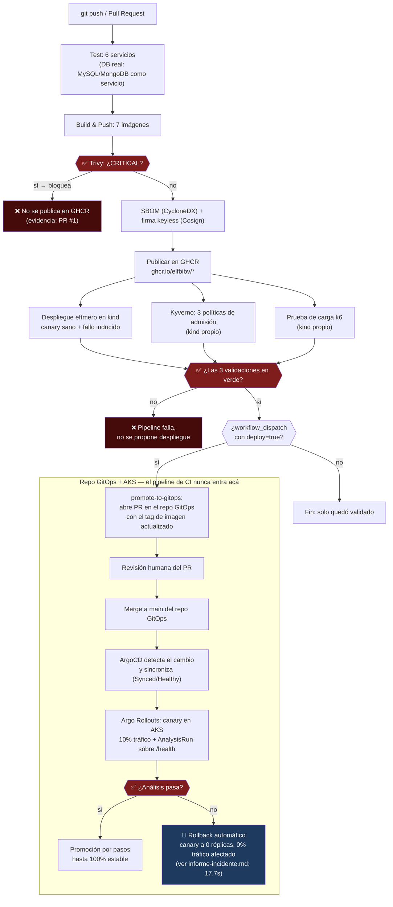

# Diagrama del flujo — del commit al clúster

Arquitectura real del pipeline implementado en [`.github/workflows/ci-cd.yml`](../.github/workflows/ci-cd.yml). Dos mitades separadas a propósito: el repo de código nunca tiene credenciales de Azure ni acceso directo al clúster — todo lo que puede hacer es proponer un cambio abriendo un PR en el [repo GitOps](https://github.com/ELFBIBv/Practicas-SA-B-202203856-gitops). El único componente con permiso de escritura sobre el clúster es ArgoCD, corriendo adentro del propio AKS.

## Puntos de validación (gates que pueden detener el flujo)

| Punto | Qué valida | Evidencia |
| --- | --- | --- |
| Trivy (en `Build & Push`) | Bloquea la imagen si tiene una CVE `CRITICAL` | [PR #1 bloqueado](https://github.com/ELFBIBv/Practicas-SA-B-202203856/pull/1) |
| Kyverno (`kyverno-policy-check`) | Rechaza pods que no cumplan registry/non-root/firma | Ver `CAMBIOS-GITOPS.md`, Fase 4 |
| k6 (`load-test`) | Umbrales de error rate y p95 de latencia | Ver `CAMBIOS-GITOPS.md`, Fase 5 |
| AnalysisRun de Argo Rollouts (canary, en `kind` y en AKS) | `/health` del candidato antes de darle más tráfico | Ver `informe-incidente.md` |

## Punto de reversión

El único punto de reversión automática es el `AnalysisRun` del canary: si `/health` del candidato falla, Argo Rollouts aborta el Rollout y escala el canary a 0 réplicas sin intervención humana, dejando el 100% del tráfico en la versión estable anterior. Documentado con evidencia real (timestamps, mensajes de error reales) en [`informe-incidente.md`](informe-incidente.md).
