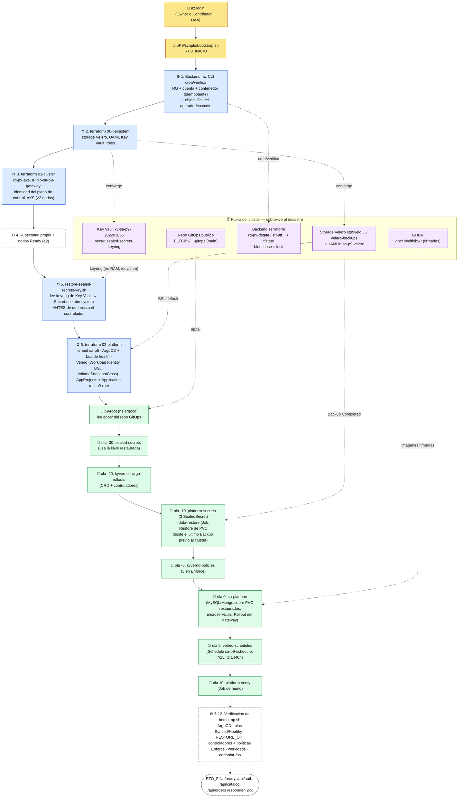

# Diagrama del bootstrap de recuperación — Práctica 9

Refleja el código real: [`scripts/bootstrap.sh`](../scripts/bootstrap.sh), [`scripts/lib/p9-config.sh`](../scripts/lib/p9-config.sh) (`P9_WAVES`), [`terraform/`](../terraform/) y [`gitops/apps/`](../gitops/apps/). Los números de etapa son los que imprime el log (`[STAGE] ===== N. ... =====`).

**Leyenda.** 🧑 acción humana permitida (solo 2: iniciar sesión y lanzar el comando) · ⚙️ automático (script/Terraform) · 🔄 automático (ArgoCD, sync waves) · 🗄️ sobrevive al desastre (fuera del clúster). No hay pasos manuales entre 🧑 y el fin del RTO.

## Quién crea y administra cada componente

| Componente | Lo crea | Lo administra después | Sobrevive al desastre |
| --- | --- | --- | --- |
| Backend de Terraform (`rg-p9-tfstate`, cuenta `stp9tf…`, contenedor `tfstate`) | `bootstrap.sh` etapa 1 con Azure CLI (huevo-gallina: no puede ser Terraform) | `lib/tfstate-backend.sh` (idempotente) | Sí |
| Storage de Velero, UAMI, Key Vault | Terraform `00-persistent` (`prevent_destroy`) | Terraform | Sí |
| Keyring de Sealed Secrets en Key Vault | Custodio, **antes** del desastre (`backup-sealed-secrets-key.sh`) | Custodio | Sí |
| RG `rg-p9-aks`, IP `pip-sa-p9-gateway`, identidad, AKS | Terraform `01-cluster` | Terraform | No (se destruye en la prueba) |
| Secret de la llave en `kube-system` | `restore-sealed-secrets-key.sh` (etapa 5) | Controlador (sin rotación) | No — se reinyecta |
| ArgoCD, Velero (servidor, node-agent, BSL, VSC), AppProjects, `p9-root` | Terraform `02-platform` | Terraform | No |
| Applications hijas | `p9-root` (desde `apps/` del repo GitOps) | `p9-root` | No |
| Controladores, políticas, secretos sellados, `sa-platform`, Schedule | Cada Application hija | ArgoCD (`selfHeal`) | No |
| PVC de MySQL/MongoDB | Job `p9-data-restore` (Velero `Restore`) | Chart `sa-platform` (los adopta) | Su **contenido** sí, vía Velero |

**Sin ciclos:** `p9-root` vive en el AppProject `p9-bootstrap`, que solo admite objetos `Application` en `argocd`; nunca puede administrar ArgoCD, sus AppProjects ni a sí misma (ver [`terraform/modules/app-of-apps-seed/main.tf`](../terraform/modules/app-of-apps-seed/main.tf)).

## Excepciones que el diagrama hace explícitas

- **Velero lo instala Terraform, no ArgoCD:** su credencial federada necesita el `oidc_issuer_url` del clúster y debe existir antes de que el Pod arranque ([`docs/diseno-velero.md`](diseno-velero.md) §1). Es automático dentro del mismo comando.
- **La llave de Sealed Secrets se reinyecta con `kubectl` desde el script:** es automático (etapa 5) y ocurre antes de ArgoCD, no es un paso del operador.
- **La custodia inicial de la llave** es una acción humana **previa** al desastre, no parte de la reconstrucción.
